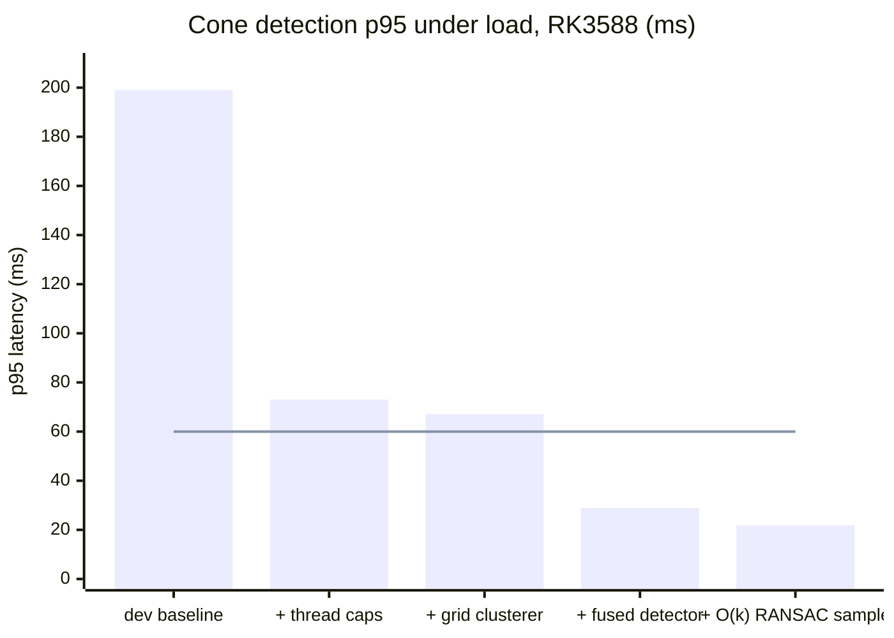
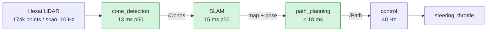

# ARM optimization: making the DV pipeline fit the RK3588

This folder documents the work on branch `pipeline_arm_optimization`. The goal is to run
the DV pipeline on the Orange Pi 5 Plus (RK3588: 4× Cortex-A76 + 4× Cortex-A55) inside
its latency budget, without changing what the car sees.

> **Branch rule.** `pipeline_arm_optimization` is never merged into `dev`, and no PR into
> `dev` is opened from it, without Raul's explicit OK.

## Status at a glance

| | Before (`dev` 6d7228e) | Now (dc5296d) | Budget | |
| --- | --- | --- | --- | --- |
| Cone detection p95, under load | **199 ms** | **21.9 ms** | ≤ 60 ms (PERF-01) | ✅ 9× faster |
| Cone detection p99, under load | 261 ms | 29.4 ms | < 100 ms (PERF-01) | ✅ |
| Scan-to-path critical path p99 | 112 ms ¹ | 63.3 ms | < 100 ms per scan | ✅ |
| Worst SLAM scan | 127–369 ms | 36 ms | < 300 ms (PERF-02) | ✅ |
| Worst planning call | **10 s** (JIT stall) | 18 ms | no stalls | ✅ |
| Node bring-up, slowest node | 128 s (cold JIT) | 0.9 s | < 120 s per node | ✅ |
| Detection quality, labelled cones | P 0.979 / R 0.956 | P 0.979 / R 0.955 | no regression | ✅ |
| IFSSIM CI, acceleration | 8/8 runs finish | **5/8 runs finish** | all finish | ❌ open, being bisected |

¹ Already with thread caps and the grid clusterer. The uncapped `dev` baseline was not run
end to end under load.

All "under load" numbers come from the Orange Pi with 3 extra busy processes
(`dv_fitbench --contention 3`), on the full 1,749-scan bag. See
[how to measure](how_to_measure.md).

## Cone detection p95 on the RK3588, step by step

Every step was measured on the same bag and the same board, with 3 busy processes competing
for the CPU. The red line is the PERF-01 budget, p95 ≤ 60 ms.

| Step | What changed | p50 / p95 / p99 / max (ms) | Doc |
| --- | --- | --- | --- |
| `dev` baseline | default thread pools, pypi clusterer | 142 / 199 / 261 / 273 | – |
| + thread caps | one thread per BLAS / Numba pool | 56 / 73 / 96 / 101 | [detection](detection.md#1-thread-caps) |
| + grid clusterer | Numba grid DBSCAN instead of the pypi package | 49.2 / 67.1 / 87.9 / 93.3 | [detection](detection.md#2-grid-clusterer) |
| + fused detector | one Numba pass per stage, no copies, no BLAS | 20.8 / 28.9 / 36.9 / 39.8 | [detection](detection.md#3-fused-detector) |
| + O(k) RANSAC sample | Floyd's sampler instead of a full shuffle | **13.4 / 21.9 / 29.4 / 32.8** | [detection](detection.md#4-ok-ransac-subsample) |

## What runs where

The critical path is LiDAR scan in → path out. Its budget is 100 ms per scan, one LiDAR
period.

## Documents

| Document | Contents |
| --- | --- |
| [detection.md](detection.md) | Thread caps, grid clusterer, fused detector, bitmap veto, O(k) RANSAC sample, per-scan RANSAC seed. Before/after data flow and per-stage charts. |
| [stalls.md](stalls.md) | The 10 s planning stall (Numba JIT), the baked cache, and the GC freeze that removed SLAM spikes. |
| [validation.md](validation.md) | How we know the output did not change: equivalence tests, labelled-cone replay, IFSSIM CI, and the open acceleration regression. |
| [how_to_measure.md](how_to_measure.md) | Board setup and the exact commands behind every number. |
| [next_steps.md](next_steps.md) | What is next, ranked. |

## Commits on the branch

| Commit | Change |
| --- | --- |
| c5957f5 | Fused Numba detection backend (SW-09), off by default |
| 6d10f6e | RANSAC seeded per scan from the scan's content |
| d7e689b, 8ae0c5d | Planner warm-up covers every signature the live planner hits (SW-04) |
| bdd3ea2 | Bake the Numba cache at install and verify it (SW-08) |
| 5d5cf3a | SLAM per-scan CPU and GC profiling |
| a48c7ea | Freeze the startup heap at activation (PERF-02) |
| 1c1b63a | `detector_backend: fused` by default |
| 84eb4f4 | `cluster_backend: grid` by default |
| dc5296d | O(k) RANSAC subsample (Floyd's algorithm) |

The full study with every raw table lives in `main_ultra`, `bench/PIPELINE_PORT_STUDY.md`, on
branch `jarvis/pipeline-port-study-83581b`.
