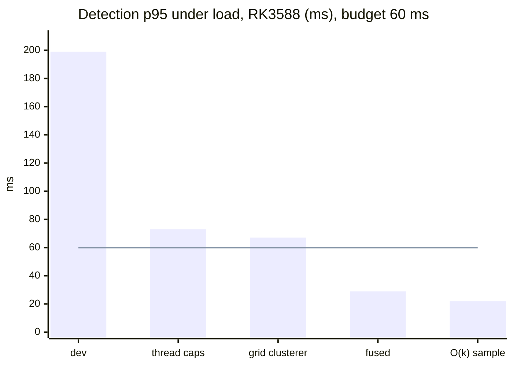
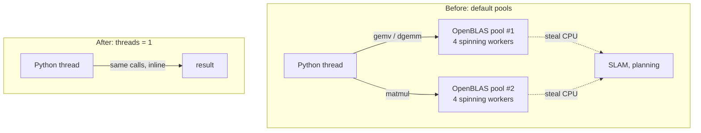
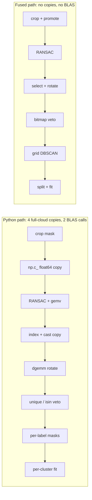
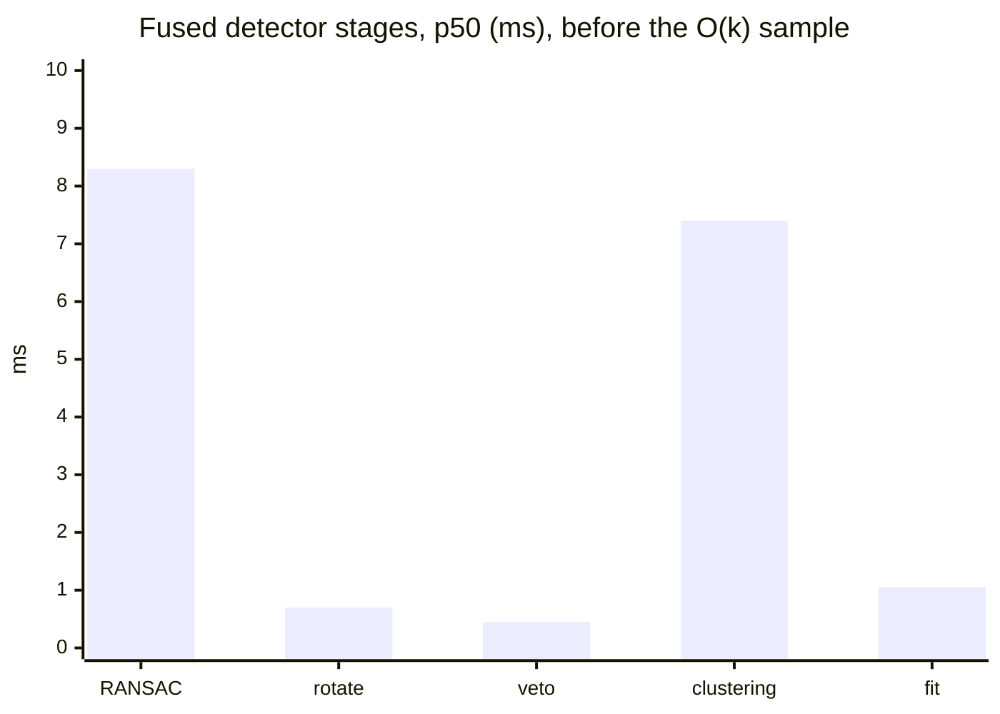
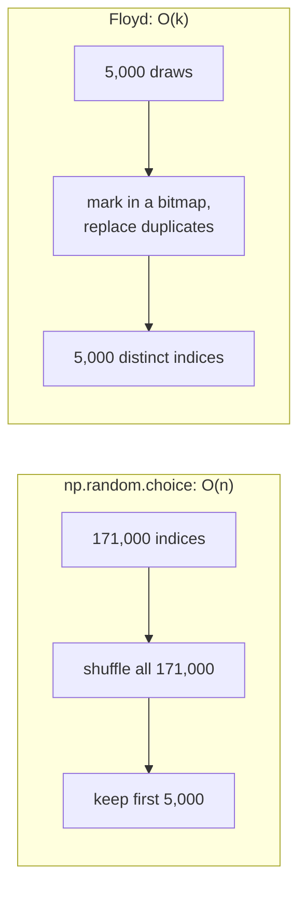
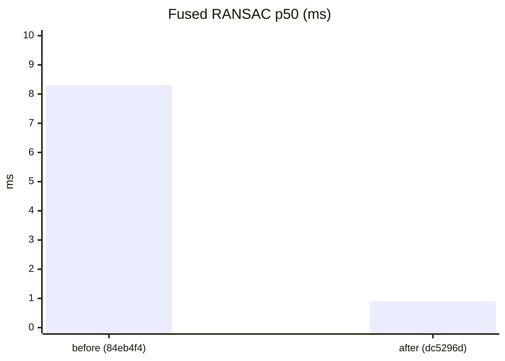
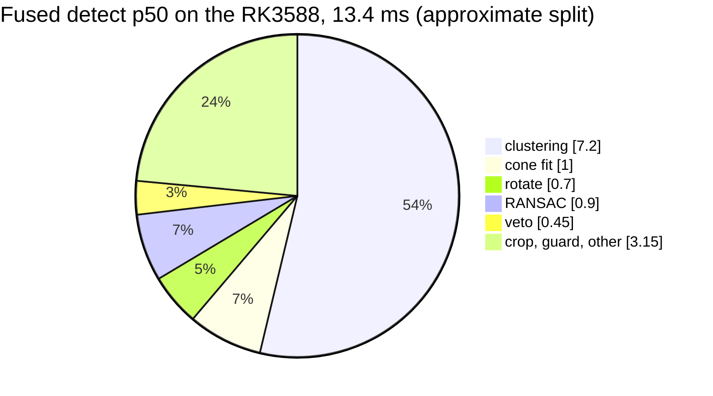

# Cone detection: from 199 ms to 22 ms p95

Cone detection was the one stage that failed its budget on the RK3588. PERF-01 asks for
p95 ≤ 60 ms and p99 < 100 ms. Under load it measured p95 199 ms.

It failed for three separate reasons:

1. **Thread pools.** Two stages called multi-threaded BLAS by accident. On a busy board,
   their spinning workers stole the CPU from everything else.
2. **Glue.** About 40 % of the time was copies, dtype changes and per-cluster Python, not
   arithmetic.
3. **Hidden O(n) work.** Drawing 5,000 random points for RANSAC shuffled all 171,000 points
   every scan.

Each fix below is measured on the Orange Pi 5 Plus with the full 1,749-scan bag. The
detector is pinned to the A76 cores and runs against 3 busy processes. Each fix also has an
equivalence check: the cones must not change, or the change must be understood.

## The detector, stage by stage

## 1. Thread caps

**Problem.** RANSAC (`A_xy.dot`) and the rotate stage (`float32 @ float64`) call OpenBLAS.
On aarch64 pip wheels, numpy and scipy each bundle their own OpenBLAS, and each spawns a
thread per core. After every call, the workers busy-wait before they sleep. With 4 A76 cores
shared with SLAM and other processes, those spinning threads take the CPU away from the
Python thread. A 3×3 rotation of 50k points is microseconds of work, but it took 12.5 ms p50
and **68 ms p99**: fork, join on the slowest worker, spin.

**Fix.** `OPENBLAS_NUM_THREADS=1 OMP_NUM_THREADS=1 NUMBA_NUM_THREADS=1
PARLAY_NUM_THREADS=1` in every pipeline unit and container.

| `dev`, RK3588, ms | p50 | p95 | p99 | max |
| --- | --- | --- | --- | --- |
| default pools, under load | 142 | 199 | 261 | 273 |
| threads = 1, under load | **56** | **73** | **96** | **101** |
| threads = 1, idle board | 55 | 73 | 95 | 104 |

With the caps, load no longer matters (56 against 55 ms). It still fails p95 ≤ 60.

## 2. Grid clusterer

`dev` clusters with the PyPI `dbscan` package. On the RK3588 the Numba grid DBSCAN that `dev`
already ships is about 1.5× faster (clustering 9 / 16 ms against 14 / 24 ms p50 / p95), and
it is exact.

| `dev`, threads = 1, under load, ms | p50 | p95 | p99 | max |
| --- | --- | --- | --- | --- |
| pypi clusterer | 56 | 73 | 96 | 101 |
| grid clusterer | **49.2** | **67.1** | **87.9** | **93.3** |

That is closer, but p95 still fails by 7 ms. The Python detector can't close the gap at
full density.

## 3. Fused detector

`detector_backend: fused` (`cone_detection/fused.py`) runs the same algorithm as the Python
path, with each stage as one Numba kernel over the raw array.

| Stage | Python path | Fused path |
| --- | --- | --- |
| crop + promote | mask, `np.c_[ones, data]`, float32 → float64 copy | one pass |
| RANSAC | `ascontiguousarray` copies, BLAS gemv per iteration | plain loops, no BLAS |
| rotate | boolean-index copy, cast copy, threaded dgemm | select + cast + 3×3 rotate in one pass |
| column veto | `np.unique` + `np.isin`, O(m log m) | dense bitmap, O(m) |
| cluster prep | `data[labels == l]` per label, **O(K·m)** | one argsort split |
| cone fit | ~15 numpy calls per cluster | one call per scan |

**Same cones.** With the same seed, fused and Python give the same plane, cones and
counters on every scan: 350/350 in the kernel bench (max |Δ| 7e-13 m), and 1749/1749 end to
end on the RK3588. Unsupported configs (another ground method,
another fit backend) fall back to the Python path with a warning.

| RK3588, grid, threads = 1, under load, ms | p50 | p95 | p99 | max |
| --- | --- | --- | --- | --- |
| Python detector | 47.8 | 63.7 | 84.5 | 90.2 |
| **fused detector** | **20.8** | **28.9** | **36.9** | **39.8** |

Fused stage times, p50 (ms):

## 4. O(k) RANSAC subsample

**Problem.** Each RANSAC iteration scores candidate planes against a random 5,000-point
subsample, which is drawn once per scan. The code drew it with
`np.random.choice(n, 5000, replace=False)`. Numba implements that as a **full permutation of
all n points**. At 171k points that took **7.4 of RANSAC's 8.3 ms**, just to pick 5,000 indices.

**Fix (dc5296d).** Floyd's algorithm draws exactly k distinct indices with k random draws. Both
the Python and fused paths share one function, `ransac.sample_without_replacement`, so they
stay identical.

Microbench on one A76 core:

| points n | `np.random.choice` | Floyd |
| --- | --- | --- |
| 40,000 | 1.25 ms | 0.18 ms |
| 110,000 | 3.65 ms | 0.15 ms |
| 171,000 (real scans) | ≈ 7 ms (inside RANSAC) | ≈ 0.15 ms |

End to end on the RK3588, under load, ms:

| | before (84eb4f4) | after (dc5296d) |
| --- | --- | --- |
| RANSAC p50 / p95 / p99 | 8.3 / 8.8 / 9.0 | **0.9 / 1.0 / 1.2** |
| detect p50 / p95 / p99 / max | 20.8 / 29.0 / 36.7 / 40.9 | **13.4 / 21.9 / 29.4 / 32.8** |
| critical path p50 / p95 / p99 / max | 56.2 / 65.1 / 71.0 / 79.5 | **43.1 / 57.0 / 63.3 / 75.2** |
| Python detector p50 / p95 | 47.8 / 63.7 | 40.7 / 57.5 |

**Output.** Fused and Python still match on 1749/1749 scans. The random draws are different
from before, so individual scans can pick a slightly different plane. That's normal RANSAC
noise: cones per scan went from 10.16 to 10.12, the map has 141 cones before and after, and
the labelled-cone check passes (see [validation](validation.md)).

## 5. RANSAC seeded per scan

Production never seeded Numba's RNG, so RANSAC picked a slightly different plane in every
process. Two runs of the *same* code disagreed on the cone count on about 60 % of scans,
which made every A/B comparison noisy. `ransac_seed_per_scan` (6d10f6e, default on) seeds
RANSAC from a CRC of the scan itself, so the same scan always gives the same plane. The cost
is not measurable.

## 6. Bitmap column veto

The column veto removes tall vertical structures (posts, people) before clustering. The
first fused version did a binary search per point and was *slower* than numpy (8.1 ms p50).
A dense bitmap over the xy cells marks the same cells in one O(m) pass. On the RK3588 it takes
0.45 ms p50, and the veto p95 on `main` went from 12.6 to 3.2 ms.

## Where the time goes now

Stage medians don't add up exactly to the total median, so read the split as approximate.
Clustering is now more than half of detection. About 3/4 of its input is ground that a
single-plane RANSAC can't remove on a non-flat track. The next lever is local ground
segmentation (SW-02b, [next steps](next_steps.md)).
