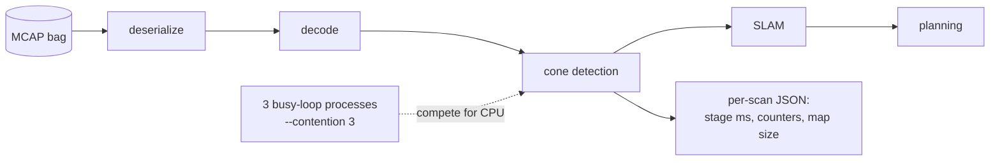

# How the numbers were measured

## The board

| | |
| --- | --- |
| Board | Orange Pi 5 Plus, RK3588 (4× Cortex-A76 @ 2.256 GHz + 4× Cortex-A55) |
| OS | Ubuntu 22.04, kernel 6.1 rockchip, ROS 2 Humble, Cyclone DDS |
| Python stack | Python 3.10, numba 0.68.1, numpy 1.24.4 |
| CPU governor | `performance` on all clusters and the DDR controller during runs |
| Pinning | the pipeline on the A76 cores (`taskset -c 4-7`) |
| Thermal | each run starts below 45 °C; temperature is logged per run |

## The data

`manual_20260920_154527`, recorded on the car's DVPC: 1,749 LiDAR scans of 174k points
each, plus odometry and IMU, about 198 s. Every RK3588 number in these docs is the whole
bag unless it says otherwise.

## `dv_fitbench`: the end-to-end number

`dv_fitbench.py` (in `main_ultra/bench`) replays the bag through the real nodes'
code (decode, cone detection, SLAM and planning) in one process. It times every scan and
writes a per-scan JSON.



- **critical path** = deserialize + decode + detect + SLAM + plan for one scan. The budget is
  100 ms per scan.
- `--contention 3` starts 3 busy processes on the same cores, standing in for the driver,
  logging and everything else on the car.

```bash
export OPENBLAS_NUM_THREADS=1 OMP_NUM_THREADS=1 MKL_NUM_THREADS=1 NUMBA_NUM_THREADS=1 PARLAY_NUM_THREADS=1
export NUMBA_CACHE_DIR=$HOME/.cache/numba_baked
python3 $REPO/deploy/dv_warm_numba.py      # bake + verify, as on the car
taskset -c 4-7 python3 dv_fitbench.py \
  --bag manual_20260920_154527_indexed.mcap --repo $REPO \
  --contention 3 --ros-param detector_backend:=fused --ros-param cluster_backend:=grid \
  --out run.json
```

Comparing two runs scan by scan (cones, outliers, vetoed, guard drops, clusters) is how
"fused == Python on 1749/1749 scans" is checked.

## Microbenchmarks

| Script | Measures |
| --- | --- |
| `pipeline_kernels_bench.py` | each detector stage, Python against fused, with an equivalence check |
| `blas_thread_probe.py` | detection with and without thread caps, with and without load |
| `planner_jit_probe.py` | Numba compiles after the planner warm-up, over 2,000 cone fields |

## Labelled-cone replay and closed loop (IFSSIM)

Both run on gtx1080pc, an x86 box with a GTX 1080 that hosts the IFSSIM CI runner.

- **Labelled cones:** `tools/sim_benchmark/run_sim_bag_benchmark.py` replays a recorded sim bag
  through a pipeline image and scores the detections against the sim's true cone positions.
- **Closed loop:** the `sim-pr` workflow in IFSSIM, dispatched with `pipeline_sha` and fixed
  `random_seeds`, so two commits drive the same tracks.

## Reading the numbers

- **p50 / p95 / p99 / max** are per-scan percentiles over the whole bag. p95 is what PERF-01
  budgets: 1 scan in 20 may be slower.
- "Under load" always means `--contention 3`.
- x86 latencies (gtx1080pc) are not comparable with RK3588 latencies. Compare configs
  within one machine only.
