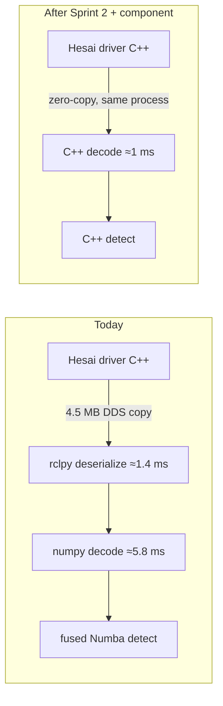

# Next steps

Detection, SLAM and planning are all inside budget on the RK3588. What's left is to prove
it's safe on the car, then to buy margin.

## Now

1. **Close the acceleration regression** ([validation](validation.md#4-ifssim-closed-loop-ci)).
   The CI bisect tells us whether it's the detector, the clusterer or a non-perception
   change. Fix it, then rerun acceleration ×10 on the final commit.
2. **Refreeze the golden fixtures.** The O(k) sample changed the RNG sequence, so the stored
   reference outputs need regenerating from dc5296d.
3. **Car test** on the Orange Pi, with the thread caps and pinning in the systemd unit and
   the baked cache. Check the bring-up log says `cache warm`.

## Then: C++ core (Sprint 2, 2–3 weeks)

Port the fused kernels 1:1 to C++ (`perception_cpp/cone_detection_core`, pybind11 first).
Numba and C++ both compile through LLVM, so the arithmetic gains little. The gains are around
it:

- No DDS copy and no Python deserialisation (about 7 ms per scan today).
- No JIT at bring-up, no GIL, more predictable tail latency.

## Ranked backlog

1. rclcpp lifecycle component next to the Hesai driver (zero-copy intra-process).
2. Local ground segmentation (SW-02b). It would remove about 3/4 of the clustering input,
   taking clustering from about 7 ms to 2–3 ms.
3. Decimation or FOV crop (SW-01). It meets budget on its own, but it grew the map from 188
   to 240 cones, so it needs a recall check first.
4. SLAM: vectorise data association and read estimates incrementally. Not needed for budget
   today.
5. Planning in C++: not needed.
