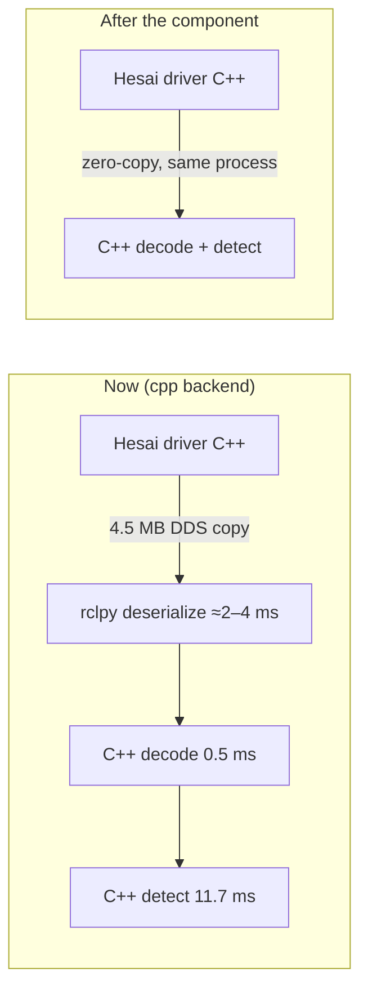

# Next steps

Detection, SLAM and planning are all inside budget on the RK3588. What's left is to prove
it's safe on the car, then to buy margin.

## Now

1. **Rerun `sim-pr` on the fixed sim** ([validation](validation.md#sim-fix-verified-ifssim864)).
   The acceleration failures were stale sim LiDAR scans. The fix, IFSSIM#864, is merged
   into IFSSIM `dev` as 1ba1e18. With it, `dev` and 84eb4f4 both finish acceleration 10/10
   with no cone hit. Once `dev`'s push check has published the fixed CI build, rerun the
   `sim-pr` check on 84eb4f4 and dc5296d. Treat any sim result at speed from before 1ba1e18
   as affected by the stale scans. Hardening SLAM and the planner against duplicate cone rows moves
   to the backlog.
2. ~~Refreeze the golden fixtures.~~ Done: `test_golden.py`, 30 real scans frozen at dc5296d
   ([validation](validation.md#12-equivalence)).
3. **Car test** on the Orange Pi, with the baked cache; check the bring-up log says `cache warm`.
   The board settings are one installer now, `sudo deploy/rk3588_tuning.sh install`
   ([changelog](../../deploy/CHANGELOG.md)): the A76 cores on `performance`, network interrupts on
   core 7, one A76 core per per-scan process through `DV_CPU_PIN`, everything else floating on
   the A55 cores. On the car, also check:
   - the LiDAR driver's load: it floats on the A55 cores 0-3 and was never measured on the Pi;
   - `rx_mac_missed` on the LiDAR's network card stays flat;
   - temperature on a hot day: every core at full clock, throttling starts at 75 °C.
4. **HIL scan drops.** Pace the sim box's LiDAR sender so a scan doesn't reach the Pi as one
   1.5 MB burst; until then a watchdog trip now and then is the LAN, not the pipeline.

## Sprint 2: C++ core

**Part 1 done: the kernels.** `perception_cpp/cone_detection_core`, behind
`detector_backend: cpp` (fused stays the default). It passes the golden test, and on the
RK3588 under load decode + detect went from 21.2 / 40.3 ms to **12.2 / 24.6 ms** p50 / p99
([detection, section 7](detection.md#7-c-core-detector_backend-cpp)). Most of the gain is
the C++ decode (7.3 → 0.5 ms).

**Next (this sprint):**

1. **Car and HIL check with `detector_backend: cpp`.** Run the HIL full check, then compare
   the bring-up log and cone counts against fused. If they match, make `cpp` the default.
2. **The rclcpp component** (backlog item 1 below): it moves the scan off DDS and Python.
   About 6 ms per scan is left there now (deserialise 1.9–4 ms, plus marker build).

## Ranked backlog

1. rclcpp lifecycle component next to the Hesai driver (zero-copy intra-process), on
   `cone_detection_core`. It needs a native version of the voxel guard's random fallback
   (Python's `default_rng` today; rare) and the seed CRC.
2. Local ground segmentation (SW-02b). It would remove about 3/4 of the clustering input,
   taking clustering from about 7 ms to 2–3 ms.
3. Decimation or FOV crop (SW-01). It meets budget on its own, but it grew the map from 188
   to 240 cones, so it needs a recall check first.
4. SLAM: vectorise data association and read estimates incrementally. Not needed for budget
   today.
5. Planning in C++: not needed.
6. Core 6 (planning + control) sits at about 99 %. Profile it on the car bag the way SLAM was
   ([validation](validation.md#slams-core-stop-waking-for-inputs-it-drops)); SLAM's core went
   from 72 to 30 % once it stopped waking for inputs it drops.
7. C++ clustering: a hash grid instead of the sorted-key search. Clustering is 6.4 ms of
   the 11.7 ms cpp detect. Do it after SW-02b, which shrinks its input. Also make crop
   skip the zero-fill (0.25 ms).
8. SLAM: reject a scan when most of its cones fail to associate. Planner: reject same-side
   cone pairs closer than about 3 m. Both guard against duplicate cone rows from a bad pose.
