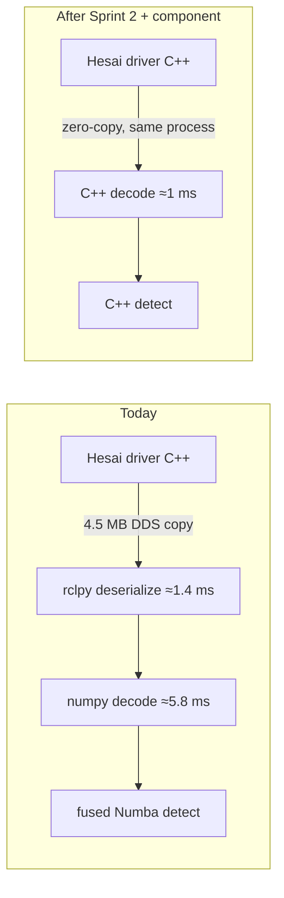

# Next steps

Detection, SLAM and planning are all inside budget on the RK3588. What's left is to prove
it's safe on the car, then to buy margin.

## Now

1. **Rerun `sim-pr` on the fixed sim** ([validation](validation.md#sim-fix-verified-ifssim864)).
   The acceleration failures were stale sim LiDAR scans. The fix, IFSSIM#864, is merged
   into IFSSIM `dev` as 1ba1e18. With it, `dev` and 84eb4f4 both finish acceleration 10/10
   with no cone hit. Once `dev`'s push check has published the fixed CI build, rerun the
   `sim-pr` check on 84eb4f4 and dc5296d. Treat any sim result at speed from before 1ba1e18
   as affected by the stale scans. Hardening SLAM and the planner against duplicate cone rows moves
   to the backlog.
2. ~~Refreeze the golden fixtures.~~ Done: `test_golden.py`, 30 real scans frozen at dc5296d
   ([validation](validation.md#12-equivalence)).
3. **Car test** on the Orange Pi, with the thread caps and pinning in the systemd unit and
   the baked cache. Check the bring-up log says `cache warm`. Add two board settings measured in
   the [HIL full check](validation.md#5-hardware-in-the-loop-the-full-sim-check-on-the-orange-pi):
   - the `performance` governor on the A76 cores (detection p99 9.6 → 5.9 ms, at no extra heat);
   - the network interrupts off core 4, the detection core (for example on core 7).
4. **HIL scan drops.** Pace the sim box's LiDAR sender so a scan doesn't reach the Pi as one
   1.5 MB burst; until then a watchdog trip now and then is the LAN, not the pipeline.

## Then: C++ core (Sprint 2, 2–3 weeks)

Port the fused kernels 1:1 to C++ (`perception_cpp/cone_detection_core`, pybind11 first).
Numba and C++ both compile through LLVM, so the arithmetic gains little. The gains are around
it:

- No DDS copy and no Python deserialisation (about 7 ms per scan today).
- No JIT at bring-up, no GIL, more predictable tail latency.

## Ranked backlog

1. rclcpp lifecycle component next to the Hesai driver (zero-copy intra-process).
2. Local ground segmentation (SW-02b). It would remove about 3/4 of the clustering input,
   taking clustering from about 7 ms to 2–3 ms.
3. Decimation or FOV crop (SW-01). It meets budget on its own, but it grew the map from 188
   to 240 cones, so it needs a recall check first.
4. SLAM: vectorise data association and read estimates incrementally. Not needed for budget
   today.
5. Planning in C++: not needed.
6. Cores 5 and 6 sit at about 96–99 % while SLAM computes about 15 ms per scan: cut the publishing
   overhead around the algorithms (about 14 ms per scan building SLAM's marker arrays).
7. SLAM: reject a scan when most of its cones fail to associate. Planner: reject same-side
   cone pairs closer than about 3 m. Both guard against duplicate cone rows from a bad pose.
