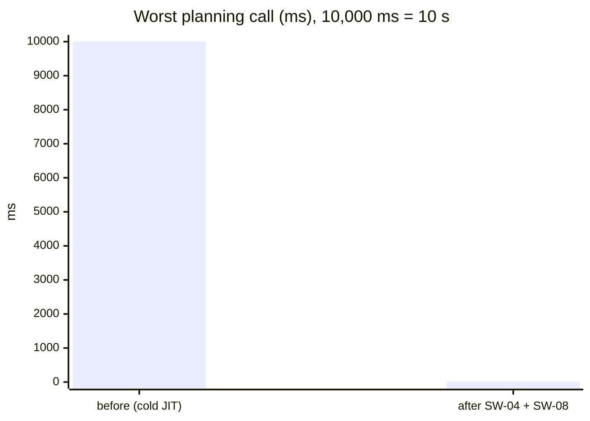
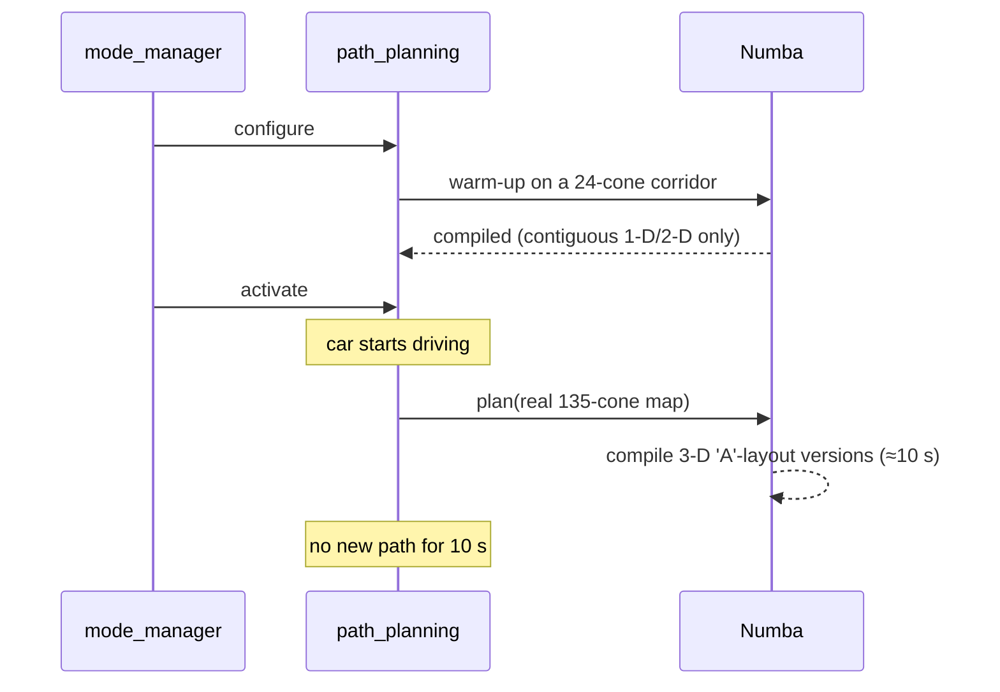
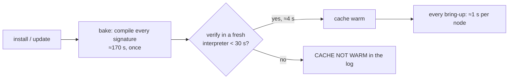
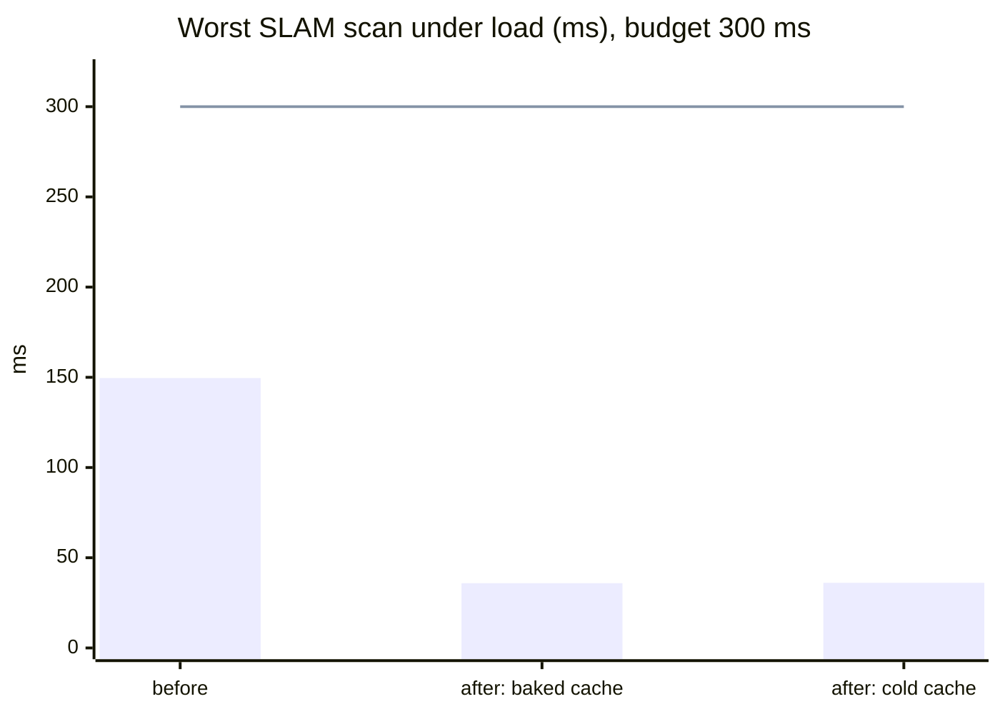

# Stalls: the 10 s planning freeze, slow bring-up and SLAM spikes

Median latency was fine for SLAM and planning. The problem was rare, very long stalls. At
10 m/s, a 10 s stall drives the car blind for 100 m. A 300 ms stall is 3 m.

| Stall | Before | After | Cause | Fix |
| --- | --- | --- | --- | --- |
| Planning, first realistic map | **10 s** once per boot | 18 ms max | Numba JIT compiling on the hot path | SW-04: warm every signature |
| Node bring-up, cold cache | 128 s (path_planning) | 0.9 s | Numba compiles everything at start-up | SW-08: bake the cache at install |
| SLAM, isolated scans | 127–369 ms | 36 ms max | Python full GC pass | PERF-02: freeze the startup heap |

## 1. The 10 s planning stall (SW-04)

Numba compiles a separate machine-code version for each combination of argument types,
including **array rank and memory layout**. The planner warm-up planned on a small, clean
24-cone corridor. A real 135-cone map takes a code path that passes sliced 3-D
(non-contiguous) arrays to `vec_dot`, `norm_of_last_axis` and `vec_angle_between`. The warm-up
never compiled those versions, so the first real `/Conos` callback compiled them. That took
5.5 s on an M1 and about 10 s on the RK3588.

**Fix (d7e689b, 8ae0c5d):**
- The warm-up also plans on a realistic ~110-cone loop: clean, noisy, and with only a few cones.
- It compiles all four layout pairs of `vec_dot` and `vec_angle_between`, plus `angle_difference`
  on 0-d arrays.
- After warm-up, a `numba:compile` listener logs an error for any compile on the hot path, so
  a future miss shows up in CI and on the car instead of as a mystery stall.

Result: 0 compiles after warm-up in 2,000 varied planner calls on the RK3588. Plan max
under load went from 10 s to 18.7 ms.

## 2. Cold bring-up and the baked cache (SW-08)

With the full warm-up, a **cold** cache (fresh image, numba upgrade, unwritable cache dir)
makes bring-up compile everything. That's 128 s for path_planning on the RK3588, over
mode_manager's 120 s budget per node.

**Fix (bdd3ea2):** `deploy/dv_warm_numba.py` runs after every install and update.
- It compiles the exact config the node will run: `params.yaml` over the strategy config, both
  detector backends, the grid clusterer, and every planner mission.
- It then starts a fresh interpreter and checks that the warm-up now takes seconds. The log
  says `cache warm` or `CACHE NOT WARM`.

| RK3588 bring-up | cone_detection | SLAM | path_planning |
| --- | --- | --- | --- |
| cold cache | 21.1 s | – | **127.6 s** ❌ |
| baked cache | 1.1 s | 0.02 s | **0.9 s** ✅ |

## 3. SLAM spikes were garbage collection (PERF-02)

SLAM's worst scan per run was 127–369 ms, on a different scan each run. Profiling CPU and GC
time per scan (5d5cf3a) showed that the 4 worst scans were exactly the 4 with a full
(generation 2) Python GC pass. Each pass walked the ~200k objects left over from start-up,
taking about 128 ms each, or about 304 ms after a cold JIT.

**Fix (a48c7ea):** every node runs `gc.collect()` and then `gc.freeze()` once at activation.
That moves the startup objects out of the collector's reach. It costs 7–270 ms once, before
the car moves.

| RK3588, under load, ms | SLAM p50 / p99 / max | worst GC pass | plan max | critical path p99 / max | scans > 100 ms |
| --- | --- | --- | --- | --- | --- |
| before | 14.7 / 27 / 149.6 | 128 | 216.7 | 73 / 258.5 | 1–4 |
| after | 14.7 / 27.1 / **35.9** | 3.4 | **17.9** | 72.0 / **80.0** | **0** |

The remaining SLAM worst case (~36 ms) is iSAM2 relinearisation, well inside budget.
