# Validation: is the output still the same?

A faster detector is worthless if it sees different cones. Every change was checked at
five levels, from cheapest to closest to the car:

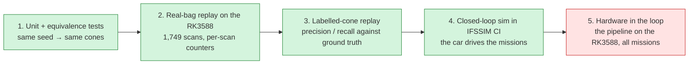

| Level | Result |
| --- | --- |
| 1. Equivalence + golden tests | ✅ fused == Python on 350/350 scans (max \|Δ\| 7e-13 m); both reproduce 30 frozen real scans |
| 2. Real-bag replay | ✅ fused == Python on 1749/1749 scans; map 141 cones on every config |
| 3. Labelled cones | ✅ precision and recall unchanged within 0.1 point |
| 4. IFSSIM closed loop | ✅ autocross and skidpad unchanged. The acceleration failures came from stale LiDAR scans in the sim ([below](#recorded-runs-what-actually-goes-wrong)); with the sim fix (IFSSIM#864) both commits finish 10/10 with no cone hit |
| 5. Hardware in the loop | ⚠️ every mission drives on the Orange Pi; two trackdrive bugs fixed; dropped LiDAR scans over the LAN still trip the watchdog now and then ([below](#5-hardware-in-the-loop-the-full-sim-check-on-the-orange-pi)) |

## 1–2. Equivalence

- `cone_detection/test/test_fused_detect.py` runs both paths with the same seed on recorded
  scans and requires identical planes, cones and counters.
- On the Orange Pi, `dv_fitbench` replays the whole 1,749-scan bag through both paths. It then
  compares per-scan cone count, RANSAC outliers, vetoed points, guard drops and cluster
  count. They match on 1749/1749 scans at dc5296d.
- **Golden fixtures** (`cone_detection/test/test_golden.py`, frozen at dc5296d): 30 real car
  scans (every 58th of the bag, Git LFS, 53 MB) and the detector's output for each under the
  production `params.yaml` config. Both backends must reproduce them: counters exactly, the plane
  to 1e-9 and cones to 1e-6 m. The outputs are identical on aarch64 (RK3588) and x86_64, so one
  reference serves both. Regenerate with `cone_detection/test/golden/make_golden.py` after a
  deliberate output change.
- Without a seed, two runs of the same code differ on ~60 % of scans. That's why RANSAC is
  now seeded per scan (6d10f6e).

## 3. Labelled-cone replay

IFSSIM records the sim's LiDAR with the true cone positions. A 217 s trackdrive bag
(1,844 frames) was replayed through every detector config on gtx1080pc, an x86 box with a
GTX 1080:

| | `dev` (Python + pypi) | 84eb4f4 (fused + grid) | **dc5296d (+ O(k) sample)** |
| --- | --- | --- | --- |
| precision | 0.9793 | 0.9794 | **0.9794** |
| recall | 0.9556 | 0.9556 | **0.9545** |
| median match error | 0.079 m | 0.080 m | **0.079 m** |
| p95 match error | 1.122 m | 1.122 m | **1.122 m** |
| big orange precision / recall | 0.938 / 0.500 | 0.933 / 0.527 | **0.939 / 0.507** |
| false big orange cones (whole bag) | 15 | 17 | **15** |
| median detect latency (x86) | 24.6 ms | 10.0 ms | **6.0 ms** |

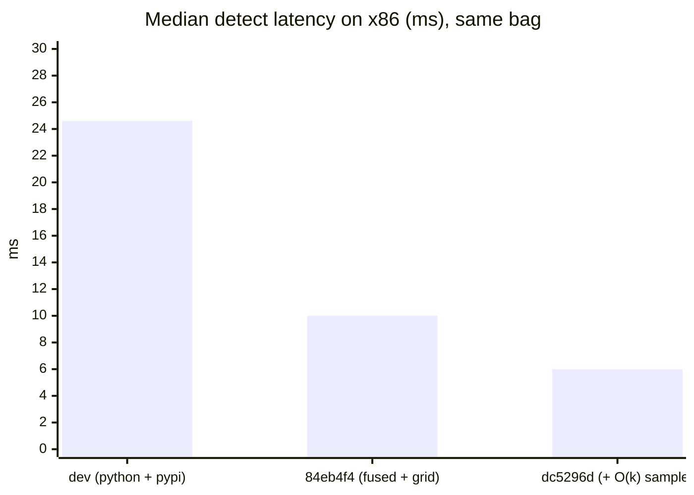

Quality is the same within noise, at a quarter of the latency.

## 4. IFSSIM closed-loop CI

IFSSIM's `sim-pr` workflow drives the car on gtx1080pc:
- acceleration, repeated (this decides pass or fail);
- skidpad;
- one fixed autocross track;
- three random autocross tracks.

Two pipeline commits were compared with the same random-track seeds
(`7380001, 7380021, 7380040`), after IFSSIM#857 added the pypi `dbscan` package to the image.

| Mission | `dev` 6d7228e | 84eb4f4 |
| --- | --- | --- |
| acceleration (5 runs) | ✅ 5/5 | ❌ **3/5**, runs 1 and 3 time out |
| 3 random autocross tracks | 3/3, 2 cones hit | 3/3, 3 cones hit |
| fixed autocross track | 111.8 s, 4 cones | 111.9 s, 5 cones |
| skidpad | 12.1 s, 1 cone | 12.1 s, 1 cone |

With the first round, 84eb4f4 timed out on 3 of 8 acceleration runs, and `dev` on 0 of 8.

### What a failed acceleration run looks like

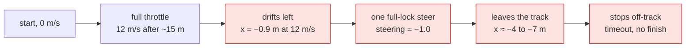

A good run also drifts slightly (x ≈ −0.4 m) but never takes the full-lock steer.

### What we know

- **Not the slow sim.** The failing commit had the *faster* sim (0.83–0.92× real time against
  0.53×). The sim is known to cause bad driving below about 0.95×, so if anything, `dev` had
  the harder conditions.
- **Not an acceleration-only config.** Every mission uses the same detection strategy.
- **The failing runs see fewer cones.** When SLAM rejected a scan's data association, the
  failing runs had 5.2 cones per scan, against 6.3–6.8 in every other acceleration run.
- **Detection quality at 5 m/s is unchanged** (labelled-cone replay above). Acceleration
  runs at 12 m/s with far-away cones, which that replay doesn't cover.

### Bisect (running)

Two config-only branches off 84eb4f4 change only `bringup/config/params.yaml`. Each runs
10 acceleration repeats in CI:

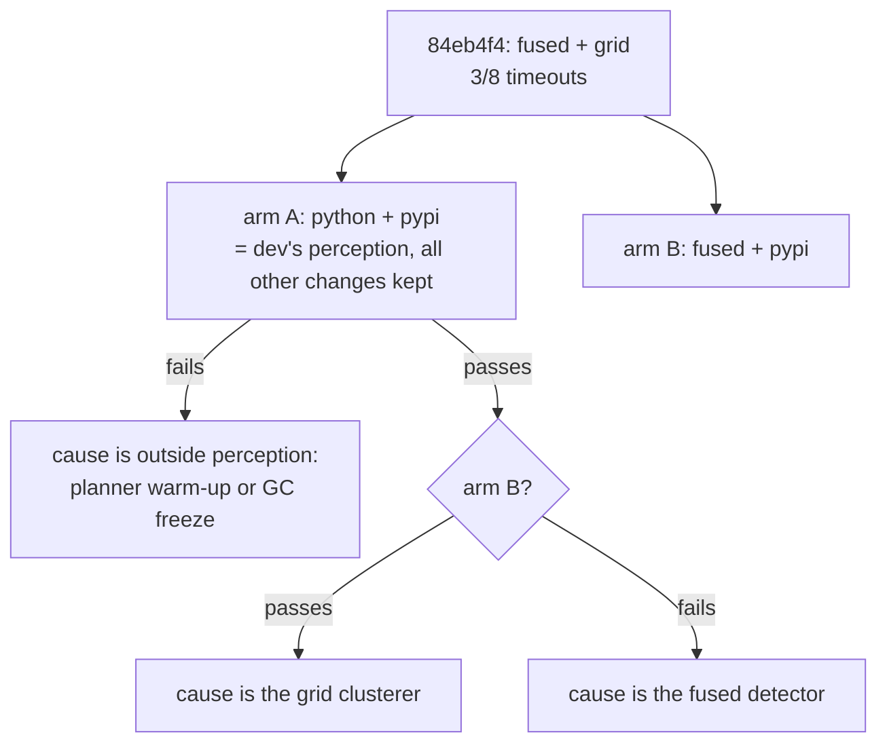

The bisect branches are deleted; each arm's commit is kept as the tag `archive/bisect-<arm>`
(for example `archive/bisect-h`).

| Arm | What differs from 84eb4f4 | Commit | CI run | Acceleration timeouts |
| --- | --- | --- | --- | --- |
| `dev` | none of our changes | 6d7228e | 3 runs | **0 / 18** |
| 84eb4f4 | – (fused + grid) | 84eb4f4 | 2 runs | 3 / 8 |
| A | python + pypi (`dev`'s perception) | 14d1721 (`archive/bisect-a`) | 43199204512 | 3 / 10 |
| B | fused + pypi | 92cb394 (`archive/bisect-b`) | 43202180731 | 1 / 10 |
| C | planner warm-up (SW-04) reverted | e4730ed (`archive/bisect-c`) | 43206681091 | 1 / 10 |
| E | GC freeze removed | 235361a (`archive/bisect-e`) | 43211865554 | 1 / 10 |
| F | RANSAC per-scan seed off | 0196176 (`archive/bisect-f`) | 43216088577 | 1 / 10 |
| H | `dev` + only the non-perception changes | d4371db (`archive/bisect-h`) | 43219769501 | **0 / 10**, 0 cones hit |
| I | H + per-scan seeding (python + pypi) | 10e5dae (`archive/bisect-i`) | 43223848290 | 2 / 20 |
| J | H + fused + grid, no seeding | 31ad31e (`archive/bisect-j`) | 43227239895 | 1 / 20 |

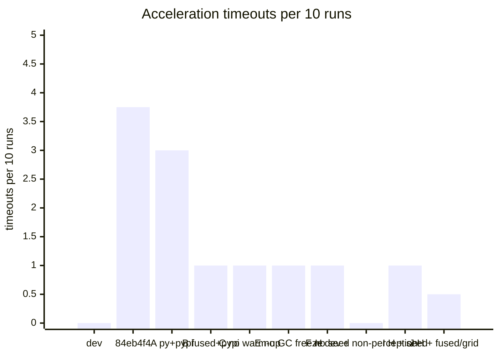

**What the bisect shows so far:**
- **The regression is real.** All our arms together time out 10 times in 58 runs (about 1 in 6);
  `dev` has 0 timeouts in 18. The chance of that by luck at our failure rate is about 3 %.
- **Perception config is cleared** (arm A uses `dev`'s python + pypi and still fails).
- **The planner warm-up is cleared**, in CI (arm C still fails) and offline: on the RK3588 the
  acceleration planner's paths are bit-for-bit identical with no warm-up, the old warm-up or
  the new one. Its `LinAlgError` lines are harmless noise: the warm-up plans a closed loop in
  acceleration mode, which that planner can't handle, using throwaway planner instances.
- **The GC freeze alone is cleared** (arm E still fails).
- **Per-scan seeding alone is cleared** (arm F still fails).
- **Arm H clears every non-perception change together**: `dev`'s perception plus planner
  warm-up, Numba bake, SLAM profiling and GC freeze finishes 10/10 with no cone hit.
- **So the cause is in the perception changes.** Every config with `dev`'s perception
  is clean (0 / 28 runs). Every config with any of our perception changes is not (10 / 58).
- **Each perception change on its own tips it over sometimes:**

  | Perception on a clean base | Acceleration timeouts |
  | --- | --- |
  | `dev`'s (`dev` ×18, H ×10) | **0 / 28** |
  | + per-scan seeding only (I, A) | 5 / 30 |
  | + fused + grid only, no seeding (J, F) | 2 / 30 |

- Neither change alters what a scan's cones *are* in a way the labelled-cone replay can
  see (same precision and recall). Both change *which* cones come out on borderline scans:
  seeding fixes the RANSAC draw per scan, and the grid clusterer splits border points
  differently from pypi. Acceleration at 12 m/s past one stretch of the course is sensitive
  to that. `dev` brushes the same left cones there but recovers.
- In every failure, at 7.4–8.8 s and close to 12 m/s, the car touches blue (left) cones, then
  takes the full-lock steer. `dev` also brushes left cones at that spot (2 cones in 10 runs)
  but recovers. The weakness exists on `dev`; our branch pushes it over the edge more often.
- Bisecting stopped here; the recorded runs below explain the mechanism.

The bisect branches exist only for CI and are not to be merged.

### Recorded runs: what actually goes wrong

Every topic except the LiDAR clouds was recorded on gtx1080pc over 15 acceleration runs of
84eb4f4 and 8 of `dev`. A recorder container on the host network ran next to the stack. One
run of each failed: 84eb4f4 seed 12 and, for the first time, a `dev` run (seed 6).

**The root cause is in the simulator, not the pipeline.** Each LiDAR scan was compared with
the sim's true pose and cone positions. The detected cones are accurate to about 1 cm.
Placing them exactly requires the car's true pose from either 16 ms or 216 ms before the
scan's stamp, and which one changes from scan to scan:

| | scans whose points are 200 ms older than their stamp | runs with ghost cones in the SLAM map |
| --- | --- | --- |
| `dev` 6d7228e | **51 %** (200 / 389) | 7 / 8 |
| 84eb4f4 | **40 %** (386 / 958) | 15 / 15 |

IFSSIM's bridge stamps each cloud with the capture time the Unreal plugin sends. On those
scans the points come from a capture two LiDAR periods (200 ms) older than that time. The
plugin source isn't in the IFSSIM repo, so the exact cause inside it is still open.

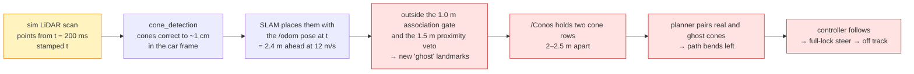

**Ghosts are in almost every run; only the failing runs act on them.** The planner's path
leaves the centre line by more than 0.5 m within 10 m only in the two failing runs:

| | first bent path | paths bent > 0.5 m | steering first > 0.3 |
| --- | --- | --- | --- |
| 84eb4f4 seed 12 ❌ | 2.7 s | **50 / 76** | 5.3 s, then full lock |
| `dev` seed 6 ❌ | 5.3 s | **20 / 58** | 7.2 s, then full lock |
| 20 passing runs | – | 0–2 per run | never (max 0.26) |

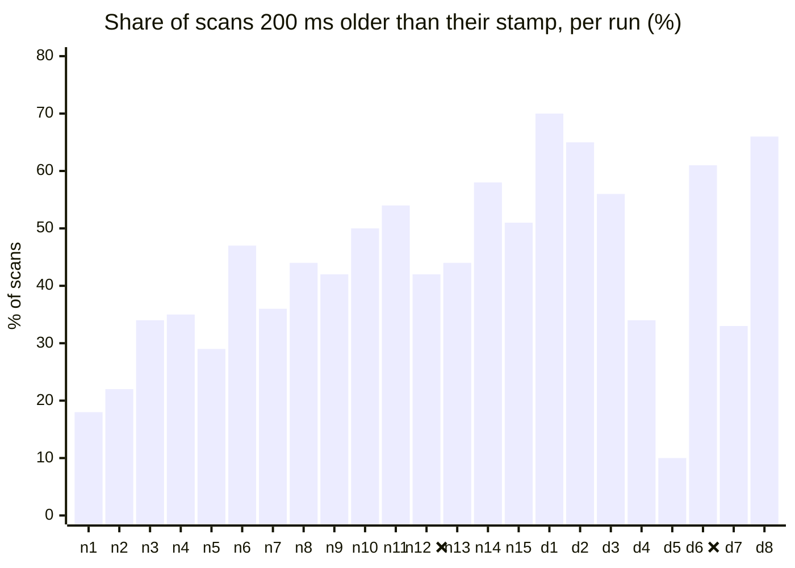

`n` = 84eb4f4 and `d` = `dev`. The failing runs aren't outliers here: stale scans are
everywhere. The one run with almost none (`d5`, 10 %) is the one run without ghosts.

Ruled out from the recordings:
- **Odometry.** `/odom` against the truth is the same in every run (about −0.6 m by 3 s).
- **The odometry lookup in SLAM.** It falls back to the newest `/odom` sample on about 2 of
  ~130 scans per run.
- **Detection accuracy.** About 1 cm on both commits.

**What this means for our branch.** The stale scans and the ghosts come from the sim, at a
similar rate on both commits. Our perception changes don't create them. They change which
cones a borderline scan yields, and that changes how the ghost rows line up for the planner.
A stretch where the planner pairs across the two rows then decides the run. That fits the
bisect: no single change is the cause, and every perception change moves the failure rate.
The car's real Hesai driver stamps its own scans, so this exact failure shouldn't happen on
the car. Duplicate landmarks from any pose error would still look the same to the planner.

**Fixes, in order:**
1. **IFSSIM:** stamp each LiDAR scan with the capture time of the points it carries. Until
   then, acceleration in CI measures this artifact more than the pipeline. **Done in
   isc-fs/IFSSIM#864, merged into IFSSIM `dev` as 1ba1e18, verified below.**
2. **SLAM:** reject a scan when most of its cones fail to associate. This is the signature of
   a bad pose or stamp, and it's better to skip that scan than to add a whole row of new
   landmarks (the existing cascade guard doesn't catch it).
3. **Planner:** reject cone pairs whose same-side spacing is under about 3 m. This is cheap
   insurance against duplicate rows.

### Sim fix verified (IFSSIM#864)

The cause was a race in the plugin's GPU readback. The game thread checked that the copy was
ready before the render thread had started it. On Vulkan the lock then returned the other
slot's buffer, which held the scan from 200 ms earlier. #864 moves the check into the render
command that runs after the copy.

The same recording was repeated on a sim packaged from #864 (79d97a3): acceleration ×10 on
each pipeline commit, same box, same scripts.

| | sim | runs finished | cones hit | scans 200 ms stale | runs with ghost cones | bent paths |
| --- | --- | --- | --- | --- | --- | --- |
| `dev` 6d7228e | `dev` | 7 / 8 | 7 | 51 % | 7 / 8 | 20 in the failing run, 2 in one passing run |
| 84eb4f4 | `dev` | 14 / 15 | 2 | 40 % | 15 / 15 | 50 in the failing run, 1 in one passing run |
| `dev` 6d7228e | **#864** | **10 / 10** | **0** | **0 %** (0 / 569) | **0 / 10** | **0** |
| 84eb4f4 | **#864** | **10 / 10** | **0** | **0 %** (0 / 544) | **0 / 10** | **0** |

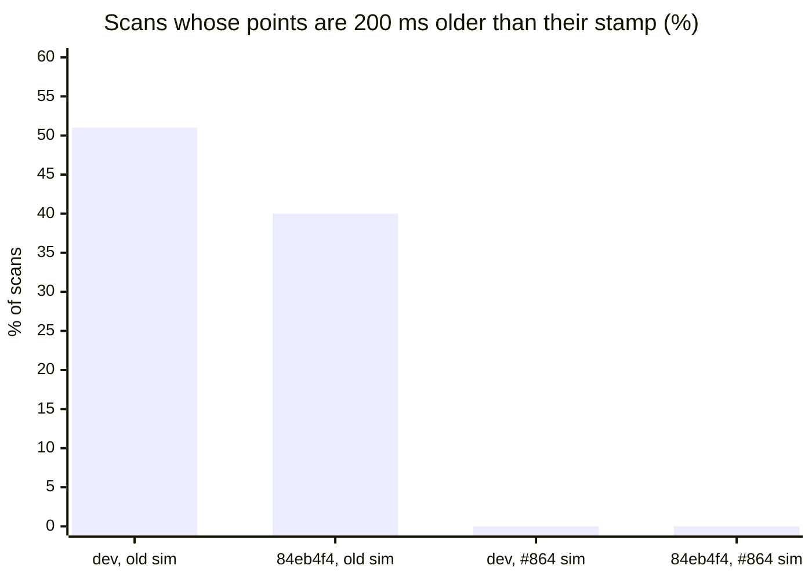

- Every scan now fits the true pose at about −16 ms, which is one sim frame (0.2 m at 12 m/s,
  well inside the 1.0 m association gate).
- The sim log's new counter ("not-ready polls") rises on nearly every readback (1942 of 1950).
  The race happened on almost every scan and is now caught each time.
- Steering stays under 0.18 in all 20 runs; lap times are unchanged (median 11.65 s `dev`,
  11.73 s 84eb4f4).

Fixes 2 and 3 are still worth doing for the car, but they no longer block the branch.

## 5. Hardware in the loop: the full sim check on the Orange Pi

The sim acts as the car. IFSSIM runs on the GPU box, and the pipeline runs on an Orange Pi 5
Plus (RK3588) over the LAN, with the same pinning and thread caps as the car. All four missions
run: acceleration, skidpad, autocross on 4 tracks, and trackdrive (10 laps) on the same 4.

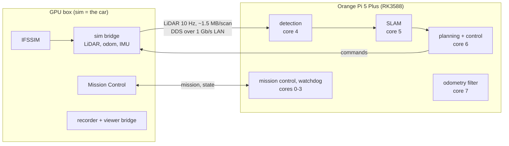

Two runs, the same in everything but the clocks:

- **ondemand**: the board's default CPU governor, with network interrupts on any core (in
  practice all on core 4).
- **performance**: the A76 cores locked at 2256 MHz, with network interrupts moved to core 7.

### Two trackdrive bugs, found and fixed

Neither depends on the Pi; both are on `dev` too. CI never caught them because it only runs
acceleration.

1. **SLAM's mission-start signals were dropped.** SLAM published `/slam/final_lap` before its
   lifecycle publishers were active, so the message went nowhere. Control kept the previous
   run's latched `true`, and trackdrive stopped after lap 1. Fix: publish after the base
   `on_activate`. Test: `cone_slam/test/test_activate_latches.py`.
2. **The car stopped a lap early.** SLAM counts a lap within 6 m of the start line, so
   `final_lap` rises while the start/finish gate is still in view. Control latched that gate
   and parked after lap 9. SLAM, stuck at 9/10, never finished. Fix: once `final_lap` rises
   mid-run, control needs `stop_latch_min_travel` (30 m) of new travel before it may latch.
   Tests: `control/test/test_stop_anchor_gating.py`.

With both fixed, every trackdrive that wasn't cut short drove 10/10 laps and finished by itself.

### Results

| Mission | ondemand | performance |
| --- | --- | --- |
| Acceleration | ✅ 13.95 s, 0 cones | ✅ 13.80 s, 0 cones |
| Skidpad | ✅ 50.15 s, 1 cone | ✅ 50.18 s, 0 cones |
| Autocross × 4 | ✅ all finished, 2–6 cones each | ✅ all finished, 4–8 cones each |
| Trackdrive 3721 | ✅ 10 laps, 1054.7 s | ❌ watchdog trip at 62 s |
| Trackdrive 3723 | ✅ 10 laps, 705.8 s | ✅ 10 laps, 700.9 s |
| Trackdrive 3725 | ❌ watchdog trip, lap 3 | ✅ 10 laps, 809.0 s, 2 cones |
| Trackdrive 3726 | ❌ watchdog trip, lap 6 | ✅ 10 laps, 859.8 s |

Latency while driving, every mission (p99, ms; the scan period is 100 ms):

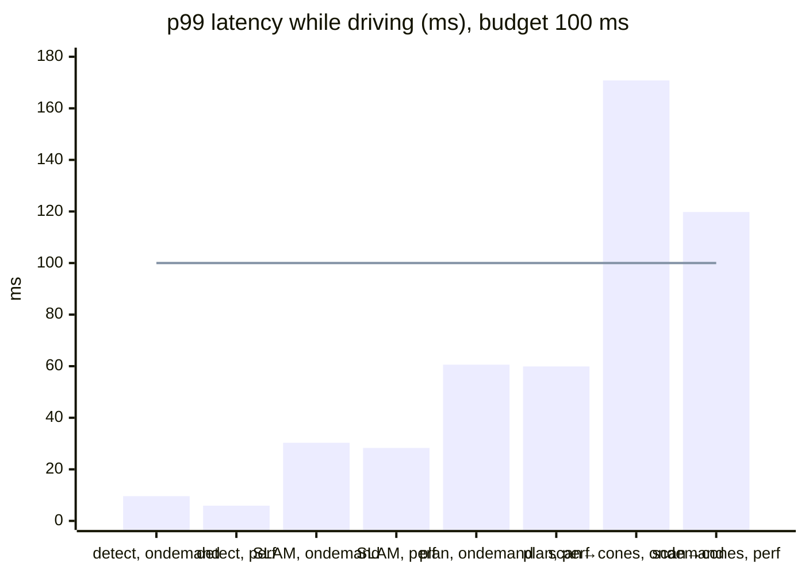

| Stage, p50 / p99 (ms) | ondemand | performance |
| --- | --- | --- |
| Detection compute | 6.1 / 9.6 | **3.8 / 5.9** |
| SLAM compute | 15.9 / 30.3 | 14.0 / 28.3 |
| Planning compute | 48.2 / 60.6 | 50.8 / 59.9 |
| Scan stamp → detections back at the box | 101.4 / 170.8 | **89.1 / 119.8** |

"Scan → cones" includes about 85 ms of sim scan timing and the LAN in both directions; the car
has neither. What matters here is the difference between the two runs.

Core load while driving (mean %):

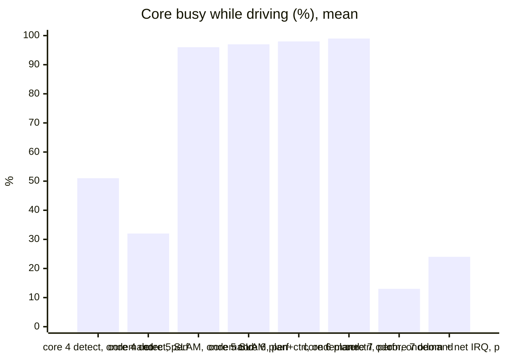

- **The performance governor is free.** The hottest zone peaked at 55.5 °C, against 56.4 °C on
  ondemand; throttling starts at 75 °C. On ondemand the A76 cores spent much of the run between
  408 and 1416 MHz, because detection's 10 Hz bursts look idle to a 10 ms sampler.
- **Lap times are steadier.** On trackdrive 3723 every lap took 70.0–70.1 s on performance,
  against 70.2–71.3 s on ondemand.
- **Cones hit don't follow latency.** Autocross hits 2–8 cones per track under both. That's the
  planner or controller cutting corners, not the board.
- **Memory is flat.** The system peaked at 1249 MiB of 5.9 GiB. SLAM stayed at 185 MiB after 1 lap
  and after 10.

### SLAM's core: stop waking for inputs it drops

Core 5 sat at 97 % while SLAM's scan work was a quarter of it. To find the rest, the real car
bag `manual_20260920_154527` (LiDAR, IMU, wheel speed, steering; 200 s, driving from 40 s)
was replayed on the Pi through the car launch, with py-spy on SLAM and the kernel's CPU
counters over the same 90 s of driving.

Most of SLAM's CPU was its single Python executor waking up for messages it then dropped. With
the default `motion_model=odom` the odometry filter fuses the IMU, wheel speed and steering, and
SLAM takes its motion from `/odom`:

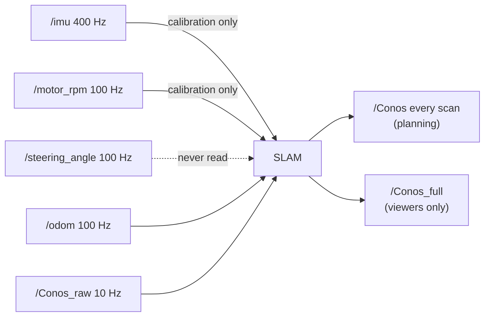

| Change | Contract kept | Test |
| --- | --- | --- |
| `/steering_angle` subscribed only with `motion_model=imu` | the imu model keeps every input | `test_imu_model_keeps_every_input` |
| `/imu` and `/motor_rpm` dropped once calibrated | subscribed again on the next activate | `test_odom_model_drops_imu_and_rpm_once_running`, `test_next_run_subscribes_again` |
| `/Conos` markers reused per landmark | same content, every scan | `test_reused_marker_matches_a_fresh_build`, `test_conos_still_goes_out_every_scan` |
| `/Conos_full` every 5th scan (`cone_map_full_delta_every_n_scans`), skipped with no subscriber | full map to a new subscriber; `1` restores every scan | `test_full_map_*`, `test_delta_every_scan_restores_the_old_cadence` |

Tests are in `cone_slam/test/test_publish_overhead.py`; all 78 SLAM tests pass on the Pi.

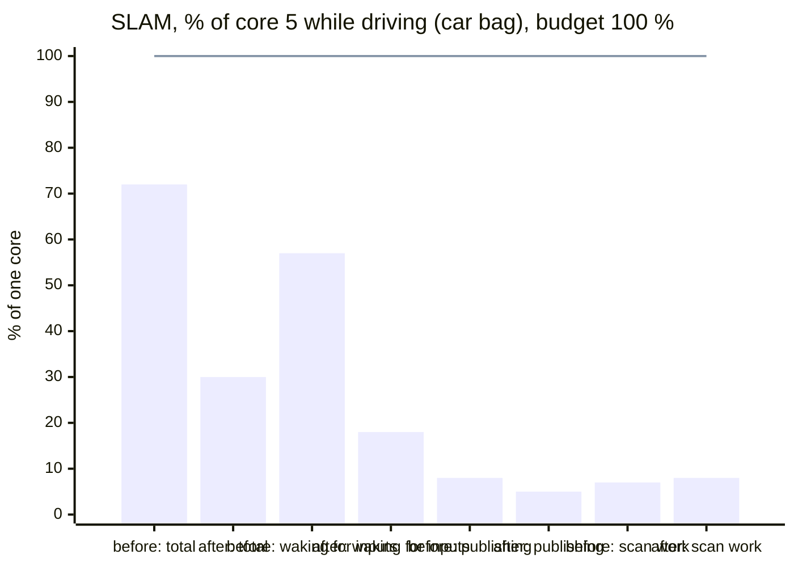

| Car bag, 90 s of driving | before (177fb4c) | after |
| --- | --- | --- |
| SLAM CPU (kernel counters) | 72 % | **30 %** |
| Publishing per scan, mean / p99 | 9.4 / 20.3 ms | **5.7 / 10.2 ms** |
| Scan time p50 / p99 (budget 100 ms) | 17.4 / 36.2 ms | **13.8 / 32.1 ms** |

**Same output.** The replay runs in real time, so runs differ slightly. Two runs of the old code
differed by up to 1.5 m in pose; one of them matched the new code within 3 cm, and two runs of
the new code matched each other within 7 cm. The map ended at 138–139 cones in every run.

What's left outside the scan work, about 18 %, is mostly `/odom` at 100 Hz, which SLAM needs,
and this replay's sim clock, which the car doesn't have. The car sends these inputs faster than
the sim (IMU 400 Hz against 185 Hz), so the saving is larger on the car than in HIL.

### A55 cores: leave them floating

The first car layout also put the A55 cores (0-3) on `performance` and pinned one management
node to each: mode manager 0, mission control 1, watchdog 2, sim supervisor 3. In the next HIL
session that layout lost more scans than the performance run. So the two were run back to back
as trackdrive sessions, the same pipeline (177fb4c), only the A55 layout changed.

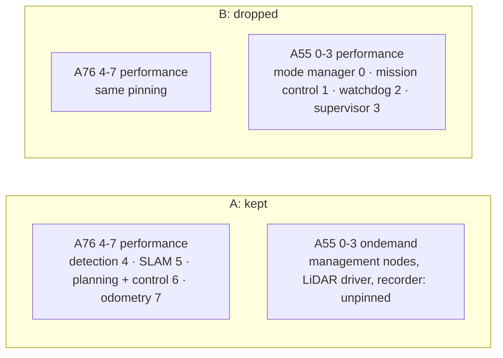

Only run 1 of each session counts: the later runs hit a restart bug (below). Driving time after
the first 40 s:

| Layout | Driving | Scans/s (sim sends 10) | Gaps > 0.25 s per min | Longest gap before the trip | Ran before the trip |
|---|---|---|---|---|---|
| **A**: A55 ondemand, unpinned | 16.2 min | **9.37** | **0.62** | 0.39 s | **8 laps** |
| B: A55 performance, pinned | 5.6 min | 9.01 | 0.89 | 0.42 s | 3 laps |

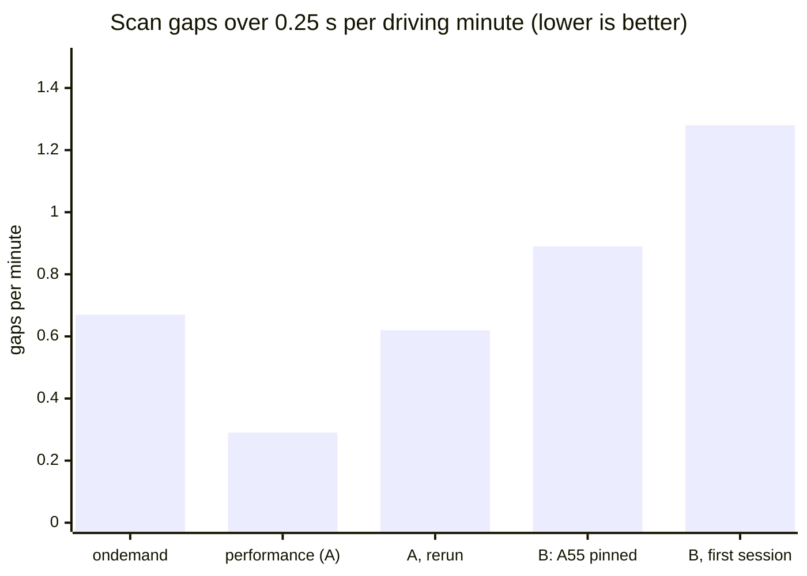

Both trips were the same kind, `/slam/pose` silent for 0.65 s against the 0.60 s budget: one
long loss, not general load. The network card missed about the same number of frames in each
session (+15.2 k and +13.7 k). One run per layout is a small sample, but it points the same
way as the first session (1.28 gaps per minute with B). The car layout keeps the A55 cores on
the board governor with the management nodes unpinned
([CHANGELOG](../../deploy/CHANGELOG.md)).

### Restarts after an emergency

In both A/B sessions every run after the first got no scans at all and tripped 5 s after
arming ("/slam/pose never published"). `/odom`, `/imu` and the clock kept flowing; only
detection's output stopped. The sim kept sending LiDAR through the resets (checked on the IFSSIM
side), and on the Pi alone, three ready → drive → emergency → off cycles on the car bag resumed
detection every time. What differs in HIL is the DDS link: detection re-created its LiDAR reader
on every activation, and the sim bridge (Fast DDS) sometimes never matched the new reader. A
later HIL session didn't reproduce it, so it's intermittent.

**Correction:** the reader wasn't the cause. These were the reassembly stalls described in the
next section: a second, independent reader on the Pi lost the same scans at the same times.
Keeping one reader is still the safer lifecycle, so the change stays.

The fix removes the step: detection creates its LiDAR subscription once at configure and keeps
it until cleanup; activation only switches scan handling on and off, and an inactive node
returns before decoding (`cone_detection/test/test_lidar_sub_lifetime.py`). The car-bag cycles
still resume every time (203, 217, 236 detections per 25 s driving). Not yet confirmed in HIL.

### LiDAR stalls: IP reassembly on the Pi

The remaining watchdog trips ("/slam/pose silent 0.6 s" mid-run, "never published" after an
emergency) were the Pi's kernel dropping LiDAR, not the pipeline. Since sim build 07b2b7e (LiDAR
pitched down, 161k hits per scan) each scan is a 2.6 MB `PointCloud2`. Fast DDS sends it as
about 40 UDP datagrams of 64 KB, which the IP layer splits into about 1,800 Ethernet frames.

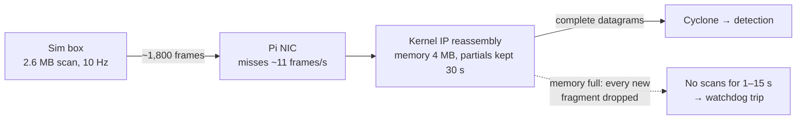

One missed frame leaves a partial datagram in reassembly memory for `ipfrag_time` (30 s). A few of
those fill the 4 MB `ipfrag_high_thresh`, and the kernel drops every new fragment until they
expire. That explains why the stalls lasted seconds, came in clusters, and why the next mission
often got no scans at all. Before the fix the Pi had failed 8.97 M reassemblies against 3.36 M
that succeeded; `UdpRcvbufErrors` was 0, so socket buffers were never the problem.

How it was isolated, one `cpp` HIL session each: per-stage timing in detection (decode + detect
1–10 ms even next to a stall), then a second raw LiDAR reader in its own process (lost the same
scans), then the box bag (`/clock`, `/imu`, `/odom` kept 22–35 ms max gaps), the box CPU and GPU
(not saturated), and the IFSSIM side (the sim and bridge send steadily). The Pi's counters
settled it.

The fix is two kernel settings on the HIL computer (`/etc/sysctl.d/60-dv-hil-dds.conf`,
[DDS tuning](../DDS_TUNING.md)): `ipfrag_high_thresh` 64 MB (about 24 scans) and `ipfrag_time`
3 s. The car doesn't need it: there the clouds stay on one computer and are never fragmented.

| HIL sessions, same pipeline (388770d) | Missions finished (of 10) | Watchdog trips | Reassembly failures |
|---|---|---|---|
| Before: fused, then 4 cpp sessions | 5, 1, 1, 7, 1 | 4 to 9 per session | ~73 % since boot |
| **After: fused** | **10** | **0** | 0.8 % |
| **After: cpp** | **10** | **0** | 0.7 % |

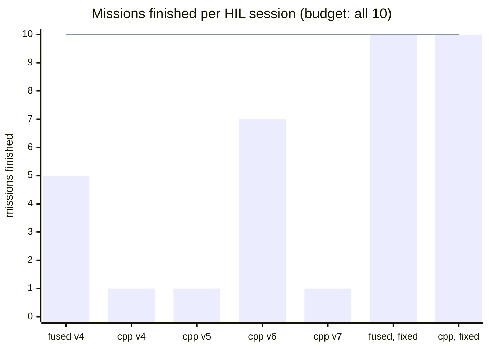

### cpp backend in HIL

With the stalls gone, the full check (acceleration, skidpad, 4 autocross, 4 × 10-lap
trackdrive) ran once per backend. `cpp` matches `fused`, so it is the default now
(`bringup/config/params.yaml`).

| | fused | cpp |
|---|---|---|
| Missions finished | 10 / 10 | 10 / 10 |
| Cones accepted per scan | 13.09 | 13.29 |
| Detection rate (sim sends 10 Hz) | 9.67 Hz | 9.75 Hz |
| Total lap time, all missions | 3,913 s | 3,899 s |
| SLAM step p50 / p99 | 18.3 / 31.4 ms | 15.9 / 34.2 ms |
| Detection CPU (core 4, % of one core) | 42.3 % | **33.7 %** |
| SLAM CPU (core 5) | 71.2 % | 61.3 % |
| Planning + control (core 6) | 99 % | 98 % |
| Cones hit | 75 | 23 |

Every mission's time is within 2 % except autocross 013726 (cpp 121.4 s against 95.4 s). The
cone-hit difference comes from three fused trackdrives (10, 17 and 28 hits); with one session
each, treat it as noise.

CPU while driving, averaged over each session (the monitor samples every 0.5 s):

```mermaid
xychart-beta
    title "A76 core load while driving, fused (first bar) vs cpp (%, budget 100)"
    x-axis ["core 4 detection", "core 5 SLAM", "core 6 planning+control", "core 7 odometry+IRQ"]
    y-axis "% of core" 0 --> 100
    bar [43, 71, 99, 28]
    bar [33, 60, 98, 26]
    line [100, 100, 100, 100]
```

`cpp` frees about a fifth of detection's core. Core 6 is the one at its budget with either
backend (Open item 2).

```mermaid
xychart-beta
    title "Trackdrive best lap, fused vs cpp (s, lower is better)"
    x-axis ["013721", "013723", "013725", "013726"]
    y-axis "best lap (s)" 60 --> 110
    bar [105.6, 70.4, 81.3, 87.5]
    bar [105.8, 70.2, 80.8, 85.6]
```

### Open

1. ~~**Scan drops cause the watchdog trips.**~~ Fixed above (IP reassembly on the Pi). Every trip is `/slam/pose` silent for 0.62–0.63 s:
   6 scans in a row missing. The Pi's network card misses frames when a 1.5 MB scan arrives as one
   burst (`rx_mac_missed` +46 k frames over the performance run). Its 1024-frame ring is at the
   maximum and the driver can't coalesce interrupts. LiDAR is best effort, so one lost frame loses
   the whole scan. Moving the interrupts to core 7 reduced the drops but didn't stop them. This is
   specific to the HIL setup: on the car the LiDAR's packets arrive spread evenly over each
   rotation. The next lever is pacing the box's sender.
2. ~~Core 5 saturated outside SLAM's algorithms.~~ Fixed above: 72 → 30 % on the car bag.
   **Core 6 still is**: planning and control sit at about 99 %. Planning computes about 50 ms
   per scan, and control shares its core. Profile it the same way before changing anything.
