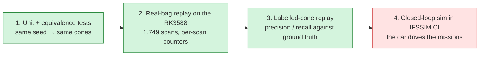
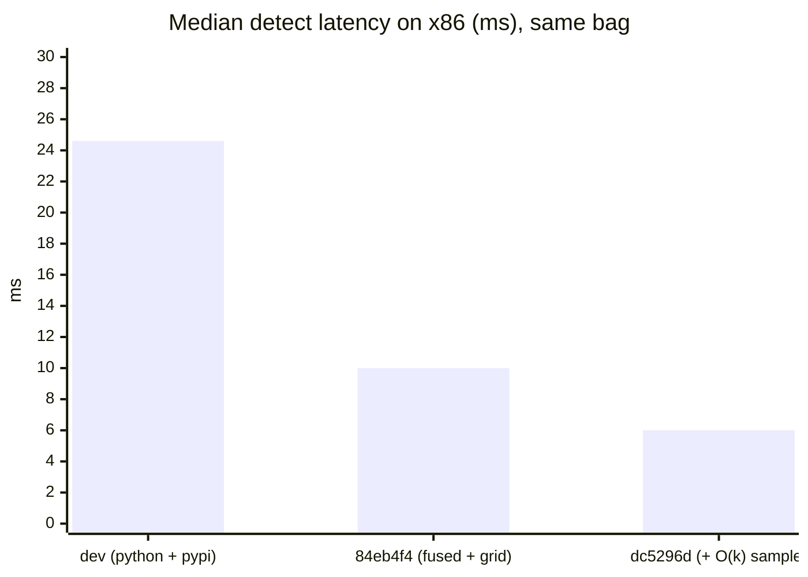
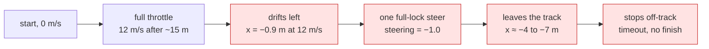
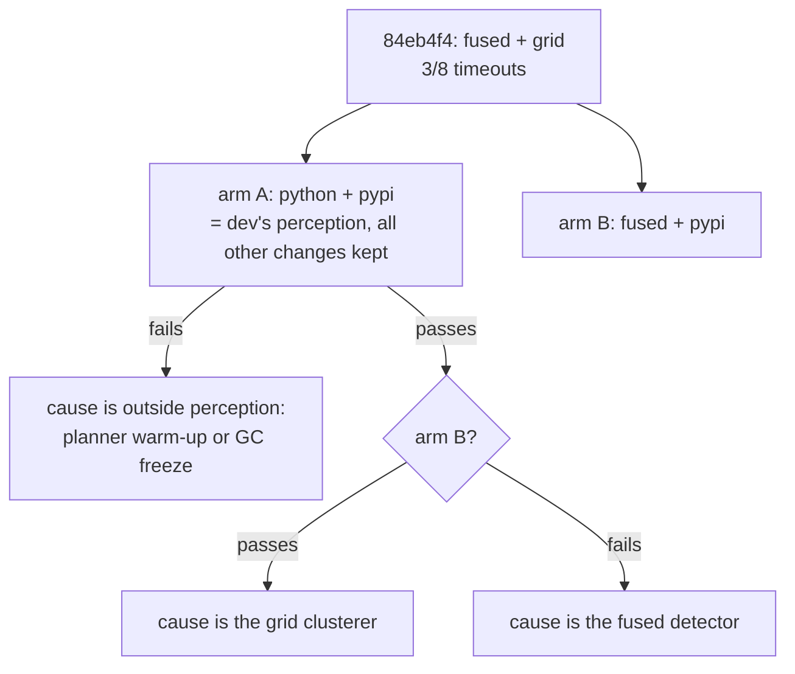

# Validation: is the output still the same?

A faster detector is worthless if it sees different cones. Every change was checked at
four levels, from cheapest to closest to the car:

| Level | Result |
| --- | --- |
| 1. Equivalence tests | ✅ fused == Python on 350/350 scans (plane, cones, counters, max \|Δ\| 7e-13 m) |
| 2. Real-bag replay | ✅ fused == Python on 1749/1749 scans; map 141 cones on every config |
| 3. Labelled cones | ✅ precision and recall unchanged within 0.1 point |
| 4. IFSSIM closed loop | ❌ autocross and skidpad unchanged; **acceleration regressed, being bisected** |

## 1–2. Equivalence

- `cone_detection/test/test_fused_detect.py` runs both paths with the same seed on recorded
  scans and requires identical planes, cones and counters.
- On the Orange Pi, `dv_fitbench` replays the whole 1,749-scan bag through both paths. It then
  compares per-scan cone count, RANSAC outliers, vetoed points, guard drops and cluster
  count. They match on 1749/1749 scans at dc5296d.
- Without a seed, two runs of the same code differ on ~60 % of scans. That's why RANSAC is
  now seeded per scan (6d10f6e).

## 3. Labelled-cone replay

IFSSIM records the sim's LiDAR with the true cone positions. A 217 s trackdrive bag
(1,844 frames) was replayed through every detector config on gtx1080pc, an x86 box with a
GTX 1080:

| | `dev` (Python + pypi) | 84eb4f4 (fused + grid) | **dc5296d (+ O(k) sample)** |
| --- | --- | --- | --- |
| precision | 0.9793 | 0.9794 | **0.9794** |
| recall | 0.9556 | 0.9556 | **0.9545** |
| median match error | 0.079 m | 0.080 m | **0.079 m** |
| p95 match error | 1.122 m | 1.122 m | **1.122 m** |
| big orange precision / recall | 0.938 / 0.500 | 0.933 / 0.527 | **0.939 / 0.507** |
| false big orange cones (whole bag) | 15 | 17 | **15** |
| median detect latency (x86) | 24.6 ms | 10.0 ms | **6.0 ms** |

Quality is the same within noise, at a quarter of the latency.

## 4. IFSSIM closed-loop CI

IFSSIM's `sim-pr` workflow drives the car on gtx1080pc:
- acceleration, repeated (this decides pass or fail);
- skidpad;
- one fixed autocross track;
- three random autocross tracks.

Two pipeline commits were compared with the same random-track seeds
(`7380001, 7380021, 7380040`), after IFSSIM#857 added the pypi `dbscan` package to the image.

| Mission | `dev` 6d7228e | 84eb4f4 |
| --- | --- | --- |
| acceleration (5 runs) | ✅ 5/5 | ❌ **3/5**, runs 1 and 3 time out |
| 3 random autocross tracks | 3/3, 2 cones hit | 3/3, 3 cones hit |
| fixed autocross track | 111.8 s, 4 cones | 111.9 s, 5 cones |
| skidpad | 12.1 s, 1 cone | 12.1 s, 1 cone |

With the first round, 84eb4f4 timed out on 3 of 8 acceleration runs, and `dev` on 0 of 8.

### What a failed acceleration run looks like

A good run also drifts slightly (x ≈ −0.4 m) but never takes the full-lock steer.

### What we know

- **Not the slow sim.** The failing commit had the *faster* sim (0.83–0.92× real time against
  0.53×). The sim is known to cause bad driving below about 0.95×, so if anything, `dev` had
  the harder conditions.
- **Not an acceleration-only config.** Every mission uses the same detection strategy.
- **The failing runs see fewer cones.** When SLAM rejected a scan's data association, the
  failing runs had 5.2 cones per scan, against 6.3–6.8 in every other acceleration run.
- **Detection quality at 5 m/s is unchanged** (labelled-cone replay above). Acceleration
  runs at 12 m/s with far-away cones, which that replay doesn't cover.

### Bisect (running)

Two config-only branches off 84eb4f4 change only `bringup/config/params.yaml`. Each runs
10 acceleration repeats in CI:

| Arm | Branch | Commit | Acceleration |
| --- | --- | --- | --- |
| A: python + pypi | `bisect/accel-python-pypi` | 14d1721 | running |
| B: fused + pypi | `bisect/accel-fused-pypi` | 92cb394 | queued |

The bisect branches exist only for CI and are not to be merged.
