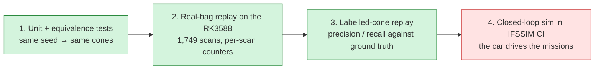
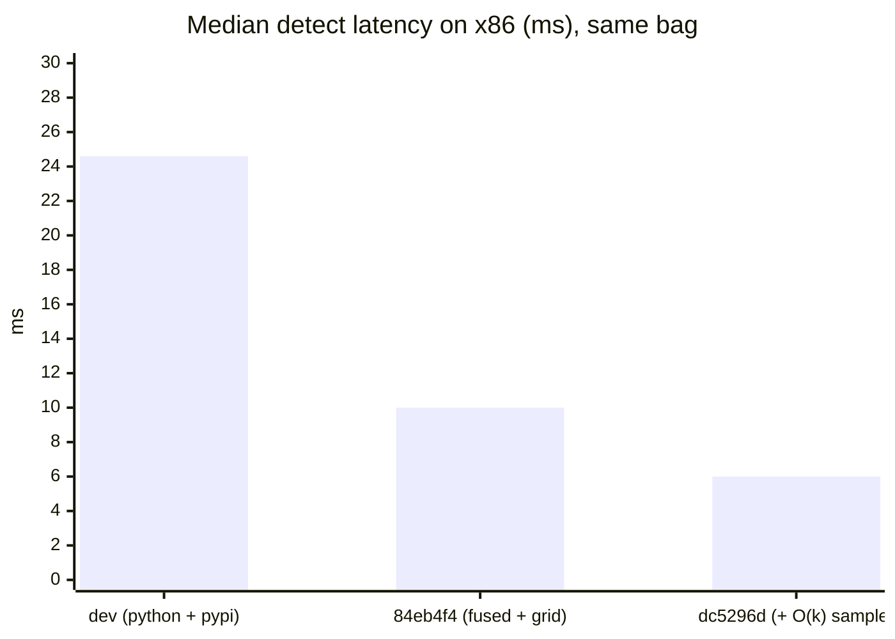
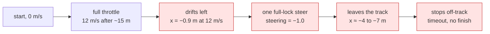
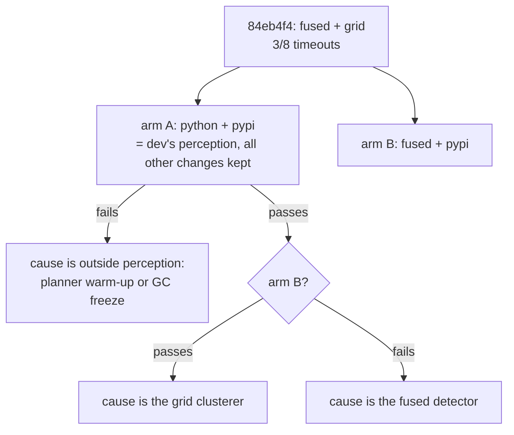
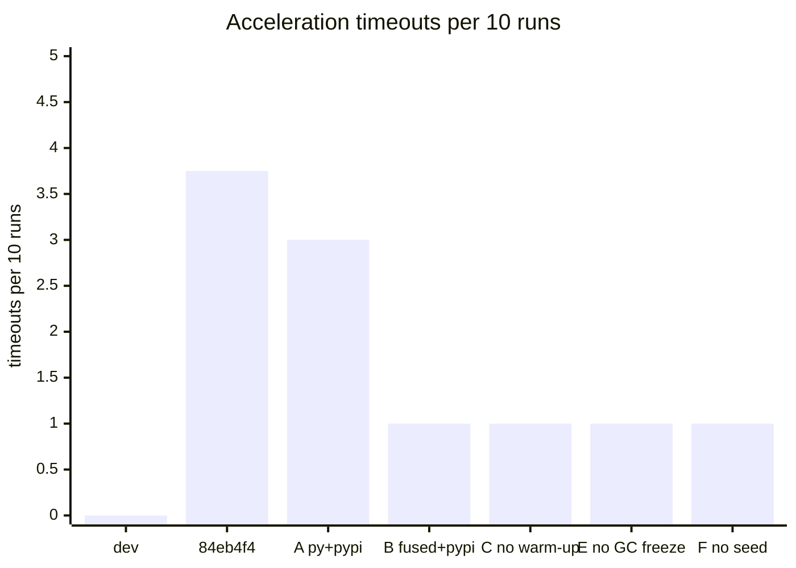

# Validation: is the output still the same?

A faster detector is worthless if it sees different cones. Every change was checked at
four levels, from cheapest to closest to the car:

| Level | Result |
| --- | --- |
| 1. Equivalence + golden tests | ✅ fused == Python on 350/350 scans (max \|Δ\| 7e-13 m); both reproduce 30 frozen real scans |
| 2. Real-bag replay | ✅ fused == Python on 1749/1749 scans; map 141 cones on every config |
| 3. Labelled cones | ✅ precision and recall unchanged within 0.1 point |
| 4. IFSSIM closed loop | ❌ autocross and skidpad unchanged; **acceleration regressed, being bisected** |

## 1–2. Equivalence

- `cone_detection/test/test_fused_detect.py` runs both paths with the same seed on recorded
  scans and requires identical planes, cones and counters.
- On the Orange Pi, `dv_fitbench` replays the whole 1,749-scan bag through both paths. It then
  compares per-scan cone count, RANSAC outliers, vetoed points, guard drops and cluster
  count. They match on 1749/1749 scans at dc5296d.
- **Golden fixtures** (`cone_detection/test/test_golden.py`, frozen at dc5296d): 30 real car
  scans (every 58th of the bag, Git LFS, 53 MB) and the detector's output for each under the
  production `params.yaml` config. Both backends must reproduce them: counters exactly, the plane
  to 1e-9 and cones to 1e-6 m. The outputs are identical on aarch64 (RK3588) and x86_64, so one
  reference serves both. Regenerate with `cone_detection/test/golden/make_golden.py` after a
  deliberate output change.
- Without a seed, two runs of the same code differ on ~60 % of scans. That's why RANSAC is
  now seeded per scan (6d10f6e).

## 3. Labelled-cone replay

IFSSIM records the sim's LiDAR with the true cone positions. A 217 s trackdrive bag
(1,844 frames) was replayed through every detector config on gtx1080pc, an x86 box with a
GTX 1080:

| | `dev` (Python + pypi) | 84eb4f4 (fused + grid) | **dc5296d (+ O(k) sample)** |
| --- | --- | --- | --- |
| precision | 0.9793 | 0.9794 | **0.9794** |
| recall | 0.9556 | 0.9556 | **0.9545** |
| median match error | 0.079 m | 0.080 m | **0.079 m** |
| p95 match error | 1.122 m | 1.122 m | **1.122 m** |
| big orange precision / recall | 0.938 / 0.500 | 0.933 / 0.527 | **0.939 / 0.507** |
| false big orange cones (whole bag) | 15 | 17 | **15** |
| median detect latency (x86) | 24.6 ms | 10.0 ms | **6.0 ms** |

Quality is the same within noise, at a quarter of the latency.

## 4. IFSSIM closed-loop CI

IFSSIM's `sim-pr` workflow drives the car on gtx1080pc:
- acceleration, repeated (this decides pass or fail);
- skidpad;
- one fixed autocross track;
- three random autocross tracks.

Two pipeline commits were compared with the same random-track seeds
(`7380001, 7380021, 7380040`), after IFSSIM#857 added the pypi `dbscan` package to the image.

| Mission | `dev` 6d7228e | 84eb4f4 |
| --- | --- | --- |
| acceleration (5 runs) | ✅ 5/5 | ❌ **3/5**, runs 1 and 3 time out |
| 3 random autocross tracks | 3/3, 2 cones hit | 3/3, 3 cones hit |
| fixed autocross track | 111.8 s, 4 cones | 111.9 s, 5 cones |
| skidpad | 12.1 s, 1 cone | 12.1 s, 1 cone |

With the first round, 84eb4f4 timed out on 3 of 8 acceleration runs, and `dev` on 0 of 8.

### What a failed acceleration run looks like

A good run also drifts slightly (x ≈ −0.4 m) but never takes the full-lock steer.

### What we know

- **Not the slow sim.** The failing commit had the *faster* sim (0.83–0.92× real time against
  0.53×). The sim is known to cause bad driving below about 0.95×, so if anything, `dev` had
  the harder conditions.
- **Not an acceleration-only config.** Every mission uses the same detection strategy.
- **The failing runs see fewer cones.** When SLAM rejected a scan's data association, the
  failing runs had 5.2 cones per scan, against 6.3–6.8 in every other acceleration run.
- **Detection quality at 5 m/s is unchanged** (labelled-cone replay above). Acceleration
  runs at 12 m/s with far-away cones, which that replay doesn't cover.

### Bisect (running)

Two config-only branches off 84eb4f4 change only `bringup/config/params.yaml`. Each runs
10 acceleration repeats in CI:

| Arm | What differs from 84eb4f4 | Commit | CI run | Acceleration timeouts |
| --- | --- | --- | --- | --- |
| `dev` | none of our changes | 6d7228e | 3 runs | **0 / 18** |
| 84eb4f4 | – (fused + grid) | 84eb4f4 | 2 runs | 3 / 8 |
| A | python + pypi (`dev`'s perception) | 14d1721 | 43199204512 | 3 / 10 |
| B | fused + pypi | 92cb394 | 43202180731 | 1 / 10 |
| C | planner warm-up (SW-04) reverted | e4730ed | 43206681091 | 1 / 10 |
| E | GC freeze removed | 235361a | 43211865554 | 1 / 10 |
| F | RANSAC per-scan seed off | 0196176 | 43216088577 | 1 / 10 |

**What the bisect shows so far:**
- **The regression is real.** All our arms together time out 10 times in 58 runs (about 1 in 6);
  `dev` has 0 timeouts in 18. The chance of that by luck at our failure rate is about 3 %.
- **Perception config is cleared** (arm A uses `dev`'s python + pypi and still fails).
- **The planner warm-up is cleared**, in CI (arm C still fails) and offline: on the RK3588 the
  acceleration planner's paths are bit-for-bit identical with no warm-up, the old warm-up or
  the new one. Its `LinAlgError` lines are harmless noise: the warm-up plans a closed loop in
  acceleration mode, which that planner can't handle, using throwaway planner instances.
- **The GC freeze alone is cleared** (arm E still fails).
- **Per-scan seeding alone is cleared** (arm F still fails).
- **No single change explains it.** Removing any one of them leaves about 1 timeout in 10.
  The Python detector is unchanged from `dev` apart from seeding. So it's either two changes
  together, or a timing effect shared by all of them.
- **Next:** split the branch in half. Arm H is `dev` plus only the non-perception changes:
  planner warm-up, Numba bake, SLAM profiling and GC freeze. If H fails, the cause is among
  those; if it passes, the perception changes are needed for it.
- In every failure, at 7.4–8.8 s and close to 12 m/s, the car touches blue (left) cones, then
  takes the full-lock steer. `dev` also brushes left cones at that spot (2 cones in 10 runs)
  but recovers. The weakness exists on `dev`; our branch pushes it over the edge more often.

The bisect branches exist only for CI and are not to be merged.
