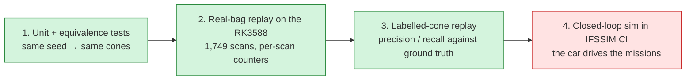
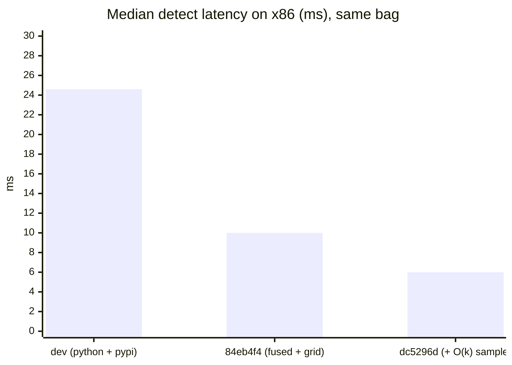
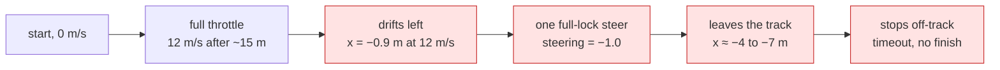
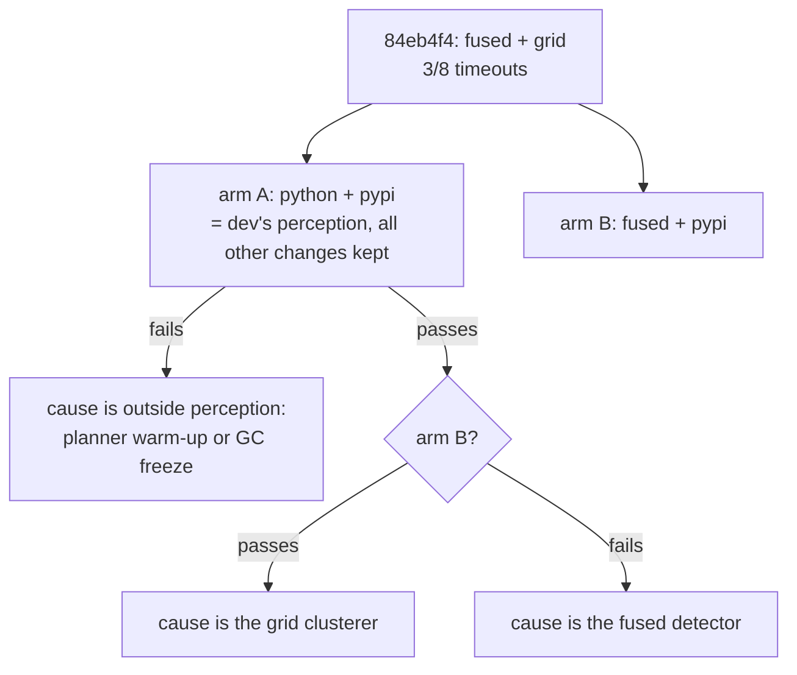
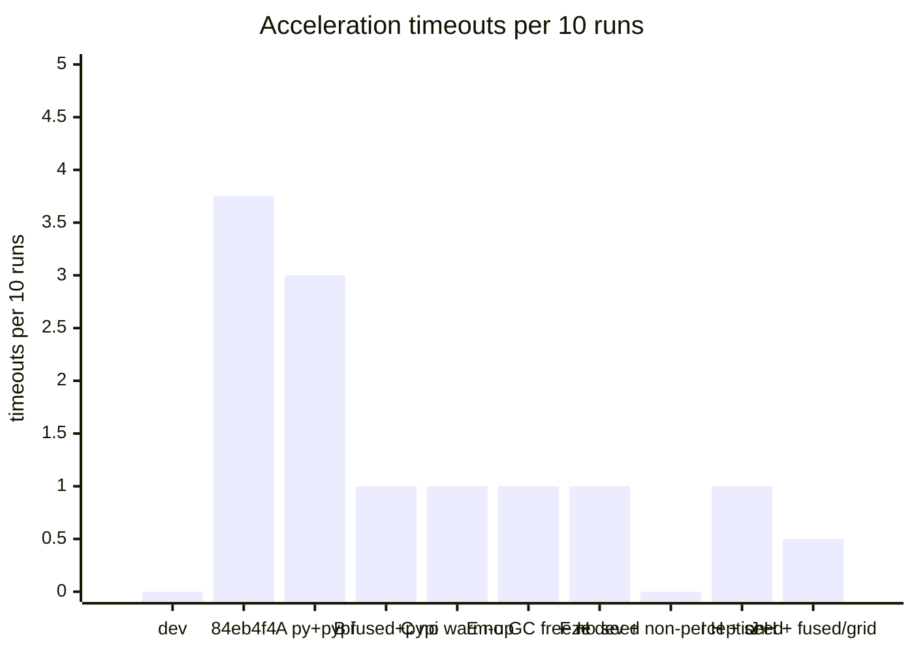
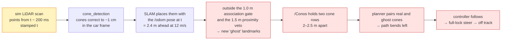
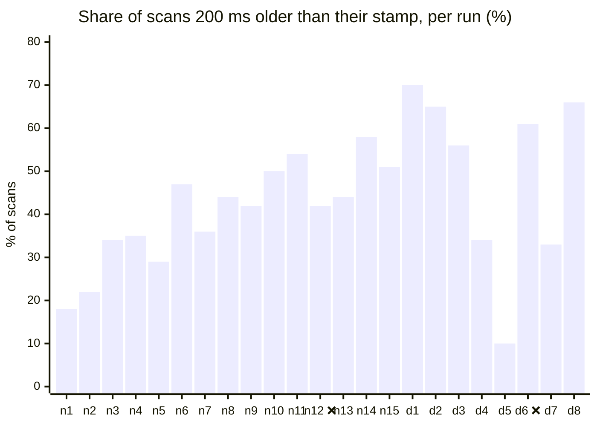

# Validation: is the output still the same?

A faster detector is worthless if it sees different cones. Every change was checked at
four levels, from cheapest to closest to the car:

| Level | Result |
| --- | --- |
| 1. Equivalence + golden tests | ✅ fused == Python on 350/350 scans (max \|Δ\| 7e-13 m); both reproduce 30 frozen real scans |
| 2. Real-bag replay | ✅ fused == Python on 1749/1749 scans; map 141 cones on every config |
| 3. Labelled cones | ✅ precision and recall unchanged within 0.1 point |
| 4. IFSSIM closed loop | ⚠️ autocross and skidpad unchanged; acceleration fails more often. Traced to stale LiDAR scans in the sim that spawn ghost cones ([below](#recorded-runs-what-actually-goes-wrong)) |

## 1–2. Equivalence

- `cone_detection/test/test_fused_detect.py` runs both paths with the same seed on recorded
  scans and requires identical planes, cones and counters.
- On the Orange Pi, `dv_fitbench` replays the whole 1,749-scan bag through both paths. It then
  compares per-scan cone count, RANSAC outliers, vetoed points, guard drops and cluster
  count. They match on 1749/1749 scans at dc5296d.
- **Golden fixtures** (`cone_detection/test/test_golden.py`, frozen at dc5296d): 30 real car
  scans (every 58th of the bag, Git LFS, 53 MB) and the detector's output for each under the
  production `params.yaml` config. Both backends must reproduce them: counters exactly, the plane
  to 1e-9 and cones to 1e-6 m. The outputs are identical on aarch64 (RK3588) and x86_64, so one
  reference serves both. Regenerate with `cone_detection/test/golden/make_golden.py` after a
  deliberate output change.
- Without a seed, two runs of the same code differ on ~60 % of scans. That's why RANSAC is
  now seeded per scan (6d10f6e).

## 3. Labelled-cone replay

IFSSIM records the sim's LiDAR with the true cone positions. A 217 s trackdrive bag
(1,844 frames) was replayed through every detector config on gtx1080pc, an x86 box with a
GTX 1080:

| | `dev` (Python + pypi) | 84eb4f4 (fused + grid) | **dc5296d (+ O(k) sample)** |
| --- | --- | --- | --- |
| precision | 0.9793 | 0.9794 | **0.9794** |
| recall | 0.9556 | 0.9556 | **0.9545** |
| median match error | 0.079 m | 0.080 m | **0.079 m** |
| p95 match error | 1.122 m | 1.122 m | **1.122 m** |
| big orange precision / recall | 0.938 / 0.500 | 0.933 / 0.527 | **0.939 / 0.507** |
| false big orange cones (whole bag) | 15 | 17 | **15** |
| median detect latency (x86) | 24.6 ms | 10.0 ms | **6.0 ms** |

Quality is the same within noise, at a quarter of the latency.

## 4. IFSSIM closed-loop CI

IFSSIM's `sim-pr` workflow drives the car on gtx1080pc:
- acceleration, repeated (this decides pass or fail);
- skidpad;
- one fixed autocross track;
- three random autocross tracks.

Two pipeline commits were compared with the same random-track seeds
(`7380001, 7380021, 7380040`), after IFSSIM#857 added the pypi `dbscan` package to the image.

| Mission | `dev` 6d7228e | 84eb4f4 |
| --- | --- | --- |
| acceleration (5 runs) | ✅ 5/5 | ❌ **3/5**, runs 1 and 3 time out |
| 3 random autocross tracks | 3/3, 2 cones hit | 3/3, 3 cones hit |
| fixed autocross track | 111.8 s, 4 cones | 111.9 s, 5 cones |
| skidpad | 12.1 s, 1 cone | 12.1 s, 1 cone |

With the first round, 84eb4f4 timed out on 3 of 8 acceleration runs, and `dev` on 0 of 8.

### What a failed acceleration run looks like

A good run also drifts slightly (x ≈ −0.4 m) but never takes the full-lock steer.

### What we know

- **Not the slow sim.** The failing commit had the *faster* sim (0.83–0.92× real time against
  0.53×). The sim is known to cause bad driving below about 0.95×, so if anything, `dev` had
  the harder conditions.
- **Not an acceleration-only config.** Every mission uses the same detection strategy.
- **The failing runs see fewer cones.** When SLAM rejected a scan's data association, the
  failing runs had 5.2 cones per scan, against 6.3–6.8 in every other acceleration run.
- **Detection quality at 5 m/s is unchanged** (labelled-cone replay above). Acceleration
  runs at 12 m/s with far-away cones, which that replay doesn't cover.

### Bisect (running)

Two config-only branches off 84eb4f4 change only `bringup/config/params.yaml`. Each runs
10 acceleration repeats in CI:

| Arm | What differs from 84eb4f4 | Commit | CI run | Acceleration timeouts |
| --- | --- | --- | --- | --- |
| `dev` | none of our changes | 6d7228e | 3 runs | **0 / 18** |
| 84eb4f4 | – (fused + grid) | 84eb4f4 | 2 runs | 3 / 8 |
| A | python + pypi (`dev`'s perception) | 14d1721 | 43199204512 | 3 / 10 |
| B | fused + pypi | 92cb394 | 43202180731 | 1 / 10 |
| C | planner warm-up (SW-04) reverted | e4730ed | 43206681091 | 1 / 10 |
| E | GC freeze removed | 235361a | 43211865554 | 1 / 10 |
| F | RANSAC per-scan seed off | 0196176 | 43216088577 | 1 / 10 |
| H | `dev` + only the non-perception changes | d4371db | 43219769501 | **0 / 10**, 0 cones hit |
| I | H + per-scan seeding (python + pypi) | 10e5dae | 43223848290 | 2 / 20 |
| J | H + fused + grid, no seeding | 31ad31e | 43227239895 | 1 / 20 |

**What the bisect shows so far:**
- **The regression is real.** All our arms together time out 10 times in 58 runs (about 1 in 6);
  `dev` has 0 timeouts in 18. The chance of that by luck at our failure rate is about 3 %.
- **Perception config is cleared** (arm A uses `dev`'s python + pypi and still fails).
- **The planner warm-up is cleared**, in CI (arm C still fails) and offline: on the RK3588 the
  acceleration planner's paths are bit-for-bit identical with no warm-up, the old warm-up or
  the new one. Its `LinAlgError` lines are harmless noise: the warm-up plans a closed loop in
  acceleration mode, which that planner can't handle, using throwaway planner instances.
- **The GC freeze alone is cleared** (arm E still fails).
- **Per-scan seeding alone is cleared** (arm F still fails).
- **Arm H clears every non-perception change together**: `dev`'s perception plus planner
  warm-up, Numba bake, SLAM profiling and GC freeze finishes 10/10 with no cone hit.
- **So the cause is in the perception changes.** Every config with `dev`'s perception
  is clean (0 / 28 runs). Every config with any of our perception changes is not (10 / 58).
- **Each perception change on its own tips it over sometimes:**

  | Perception on a clean base | Acceleration timeouts |
  | --- | --- |
  | `dev`'s (`dev` ×18, H ×10) | **0 / 28** |
  | + per-scan seeding only (I, A) | 5 / 30 |
  | + fused + grid only, no seeding (J, F) | 2 / 30 |

- Neither change alters what a scan's cones *are* in a way the labelled-cone replay can
  see (same precision and recall). Both change *which* cones come out on borderline scans:
  seeding fixes the RANSAC draw per scan, and the grid clusterer splits border points
  differently from pypi. Acceleration at 12 m/s past one stretch of the course is sensitive
  to that. `dev` brushes the same left cones there but recovers.
- In every failure, at 7.4–8.8 s and close to 12 m/s, the car touches blue (left) cones, then
  takes the full-lock steer. `dev` also brushes left cones at that spot (2 cones in 10 runs)
  but recovers. The weakness exists on `dev`; our branch pushes it over the edge more often.
- Bisecting stopped here; the recorded runs below explain the mechanism.

The bisect branches exist only for CI and are not to be merged.

### Recorded runs: what actually goes wrong

Every topic except the LiDAR clouds was recorded on gtx1080pc over 15 acceleration runs of
84eb4f4 and 8 of `dev`. A recorder container on the host network ran next to the stack. One
run of each failed: 84eb4f4 seed 12 and, for the first time, a `dev` run (seed 6).

**The root cause is in the simulator, not the pipeline.** Each LiDAR scan was compared with
the sim's true pose and cone positions. The detected cones are accurate to about 1 cm.
Placing them exactly requires the car's true pose from either 16 ms or 216 ms before the
scan's stamp, and which one changes from scan to scan:

| | scans whose points are 200 ms older than their stamp | runs with ghost cones in the SLAM map |
| --- | --- | --- |
| `dev` 6d7228e | **51 %** (200 / 389) | 7 / 8 |
| 84eb4f4 | **40 %** (386 / 958) | 15 / 15 |

IFSSIM's bridge stamps each cloud with the capture time the Unreal plugin sends. On those
scans the points come from a capture two LiDAR periods (200 ms) older than that time. The
plugin source isn't in the IFSSIM repo, so the exact cause inside it is still open.

**Ghosts are in almost every run; only the failing runs act on them.** The planner's path
leaves the centre line by more than 0.5 m within 10 m only in the two failing runs:

| | first bent path | paths bent > 0.5 m | steering first > 0.3 |
| --- | --- | --- | --- |
| 84eb4f4 seed 12 ❌ | 2.7 s | **50 / 76** | 5.3 s, then full lock |
| `dev` seed 6 ❌ | 5.3 s | **20 / 58** | 7.2 s, then full lock |
| 20 passing runs | – | 0–2 per run | never (max 0.26) |

`n` = 84eb4f4 and `d` = `dev`. The failing runs aren't outliers here: stale scans are
everywhere. The one run with almost none (`d5`, 10 %) is the one run without ghosts.

Ruled out from the recordings:
- **Odometry.** `/odom` against the truth is the same in every run (about −0.6 m by 3 s).
- **The odometry lookup in SLAM.** It falls back to the newest `/odom` sample on about 2 of
  ~130 scans per run.
- **Detection accuracy.** About 1 cm on both commits.

**What this means for our branch.** The stale scans and the ghosts come from the sim, at a
similar rate on both commits. Our perception changes don't create them. They change which
cones a borderline scan yields, and that changes how the ghost rows line up for the planner.
A stretch where the planner pairs across the two rows then decides the run. That fits the
bisect: no single change is the cause, and every perception change moves the failure rate.
The car's real Hesai driver stamps its own scans, so this exact failure shouldn't happen on
the car. Duplicate landmarks from any pose error would still look the same to the planner.

**Fixes, in order:**
1. **IFSSIM:** stamp each LiDAR scan with the capture time of the points it carries. Until
   then, acceleration in CI measures this artifact more than the pipeline.
2. **SLAM:** reject a scan when most of its cones fail to associate. This is the signature of
   a bad pose or stamp, and it's better to skip that scan than to add a whole row of new
   landmarks (the existing cascade guard doesn't catch it).
3. **Planner:** reject cone pairs whose same-side spacing is under about 3 m. This is cheap
   insurance against duplicate rows.
